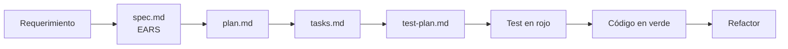

# Sistema de gestión de tickets de soporte

Aplicación web para centros de atención telefónica. Un representante registra la consulta de un cliente como un **ticket**, la sigue con un hilo cronológico de **hitos** inmutables, y el sistema **notifica** a cada parte cuando hay novedades. Es el trabajo práctico final de **Algoritmos y Programación III**.

> **Estado**: la API y la interfaz web están implementadas.
> El avance de cada área está en el [índice de specs](specs/README.md#índice).

## Qué hace

| Área | Funcionalidad |
|------|---------------|
| Usuarios y accesos | Roles `Admin`, `Representative` y `Client`, login con contraseña hasheada, emails únicos y baja lógica |
| Catálogo | ABM de rubros, tipos de producto y productos (los productos con baja lógica) |
| Tickets | Creación por el representante, ciclo de vida **Nuevo → En Progreso → Cerrado** y reapertura con el mismo representante |
| Hitos | Hilo cronológico entre cliente y representante, **inmutable** para preservar el historial ante disputas |
| Auditoría | Cada cambio de estado registra quién lo hizo y la fecha y hora exactas (UTC) |
| Privacidad | Cada cliente ve solo sus tickets, y cada representante solo los que tiene asignados |
| Notificaciones | Avisos automáticos por mail o WhatsApp según el canal preferido del usuario (envío simulado) |

Requerimientos completos: [docs/REQUERIMIENTOS.md](docs/REQUERIMIENTOS.md).

## Stack

| Área | Herramienta |
|------|-------------|
| Lenguaje | Python 3.12 |
| Web | Flask (application factory + blueprints) |
| Persistencia | SQLAlchemy 2.0 sobre SQLite |
| Interfaz web | HTML, CSS y JavaScript estáticos servidos por Flask, sin compilación ni dependencias de ejecución |
| Tests | pytest + pytest-cov (cobertura mínima del 90 %) |
| Tests de la interfaz | Node 22 (`node --test`) y Playwright, solo de desarrollo y CI |
| Lint y formato | ruff |
| CI | GitHub Actions |

El stack es deliberadamente mínimo: cualquier dependencia nueva requiere una decisión registrada en Engram (`tp-final/decision/*`) y referenciada en [MEMORY.md](MEMORY.md).

## Metodología de desarrollo

El proyecto combina tres prácticas, cada una con un rol distinto:

| Práctica | Para qué la usamos |
|----------|--------------------|
| **Spec-Driven Development** (*spec-as-source*) | La especificación es la fuente de verdad y el código se deriva de ella. Ningún cambio de comportamiento entra sin modificar antes su spec. |
| **EARS** (*Easy Approach to Requirements Syntax*) | Los requerimientos se escriben como frases atómicas y verificables, por ejemplo: *"**Mientras** el ticket está en `Closed`, **cuando** el cliente lo reabre, **el sistema deberá** pasarlo a `InProgress`."* |
| **TDD** | Cada spec se implementa con red → green → refactor, y cada test cita la spec que verifica. |

### De la spec al código



Cada área funcional tiene su carpeta en [specs/](specs/) con hasta cuatro archivos:

| Archivo | Responde |
|---------|----------|
| `spec.md` | **Qué** debe hacer el sistema |
| `plan.md` | **Cómo** se implementa |
| `tasks.md` | **En qué orden** se hace |
| `test-plan.md` | **Cómo se verifica** |

`spec.md` existe siempre. Los otros tres se crean al empezar a trabajar el área, antes de escribir código.

### Trazabilidad

Cada pieza referencia a la anterior, así que cualquier línea de código se puede seguir hasta su requerimiento:

```
RF 1.4.5  →  SPEC-TKT-11  →  T-TKT-07  →  TC-TKT-11a  →  test_closed_ticket_can_be_reopened_by_client
```

## Arquitectura

Arquitectura en capas **Controller → Service → Repository**, con dos patrones de diseño centrales:

- **State**: el ciclo de vida del ticket. Cada estado define qué transiciones permite, y las inválidas se rechazan.
- **Strategy**: el canal de notificación. Agregar un canal nuevo es sumar una clase.

| Diagrama | Contenido |
|----------|-----------|
| [Clases](diagrams/classes.md) | Modelo de dominio y capas de aplicación |
| [Secuencias](diagrams/sequences/) | 22 flujos en 6 archivos, uno por área, cada uno con las specs que cubre |

Los diagramas están en Mermaid y se ven directamente en GitHub.

## Estructura del repositorio

```
├── README.md
├── AGENTS.md            # Guía de trabajo para personas y agentes de IA
├── MEMORY.md            # Estado del proyecto, cambios con su motivación y próximos pasos
├── docs/
│   ├── constitution.md  # Principios innegociables
│   └── REQUERIMIENTOS.md # Requerimientos funcionales y no funcionales
├── specs/               # Una carpeta por área: spec, plan, tasks y test-plan
├── diagrams/            # Diagramas de clases y de secuencia (Mermaid)
├── app/                 # Código; la interfaz web está en app/static/
├── tests/               # Tests unitarios, de integración y de la interfaz (tests/ui/)
├── package.json         # Solo herramientas de prueba de la interfaz (Playwright)
├── playwright.config.js
└── .github/workflows/ci.yml
```

## Documentación del proyecto

Leer en este orden:

1. [docs/constitution.md](docs/constitution.md): 6 principios innegociables (stack, spec y código, lógica e interfaz, tests, datos del usuario e idioma). Prevalecen sobre todo lo demás.
2. [AGENTS.md](AGENTS.md): convenciones, patrones, prohibiciones, flujo de trabajo, testing y estilo de commits.
3. [MEMORY.md](MEMORY.md): estado actual, cambios con su motivación y próximos pasos. Las decisiones con su justificación y los errores a evitar están en Engram (proyecto `tp-final`).
4. [specs/README.md](specs/README.md): sintaxis EARS e índice de áreas.

## Puesta en marcha

```bash
python -m venv .venv && source .venv/bin/activate
pip install -r requirements.txt -r requirements-dev.txt
flask --app app init-db
flask --app app create-admin
flask --app app run --debug
```

La interfaz web se sirve en `http://127.0.0.1:5000/` con la misma aplicación (no requiere compilar ni instalar nada para usarla).

Pruebas de la interfaz (requieren Node 22; solo de desarrollo):

```bash
npm ci
npm run test:js                  # pruebas unitarias de los módulos JavaScript puros
npx playwright install chromium  # una sola vez
npm run test:e2e                 # pruebas en un navegador real
```

Validaciones locales (las mismas que corre el CI, que además ejecuta `npm run test:js` y `npm run test:e2e` en jobs aparte):

```bash
ruff check . && ruff format --check . && pytest --cov=app --cov-fail-under=90
```

## Cómo contribuir

1. Leer `MEMORY.md`, buscar el tema en Engram (`mem_search`) y elegir la próxima task pendiente de un área.
2. Si el cambio no tiene spec, escribirla primero en `spec.md` y que el equipo la apruebe.
3. Implementar con TDD, citando el ID de la spec en cada test.
4. Abrir un PR chico (menos de 400 líneas) con las specs y tasks que cubre, y esperar el CI en verde.

Los commits siguen [Conventional Commits](https://www.conventionalcommits.org/) en inglés, por ejemplo `feat(ticket): reopen closed ticket with same representative`. El detalle completo está en [AGENTS.md](AGENTS.md#estilo-de-commits-y-prs).
