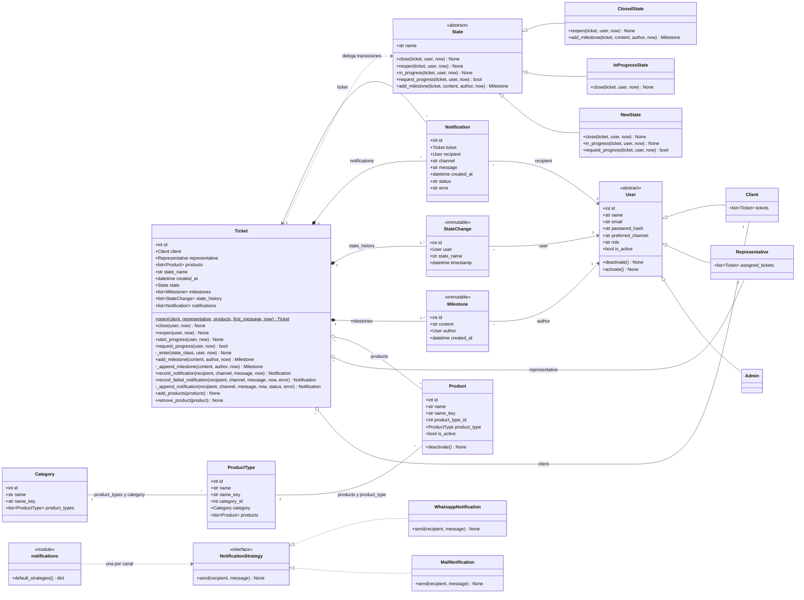

# Diagrama de clases

Versión en Mermaid del diagrama de clases. Se divide en dos vistas para que sea legible:

1. **Modelo de dominio**: entidades, relaciones y los patrones State y Strategy.
2. **Capas de aplicación**: controllers, services y repositories (Controller → Service → Repository).

Los nombres siguen la convención de Python (`snake_case` para atributos y métodos), igual que los [diagramas de secuencia](sequences/).

## 1. Modelo de dominio

### Notas del modelo

- **Patrón State**: los métodos de `State` lanzan `InvalidTransitionError` por defecto, y cada estado concreto sobrescribe solo sus transiciones válidas. En la base solo se persiste `state_name`; la propiedad `state` lo convierte en el objeto `State` correspondiente. Las clases de estado no son entidades mapeadas.

  | Desde | `in_progress` | `close` | `reopen` |
  |-------|---------------|---------|----------|
  | `NewState` | → `InProgress` | → `Closed` | ❌ |
  | `InProgressState` | ❌ | → `Closed` | ❌ |
  | `ClosedState` | ❌ | ❌ | → `InProgress` |

- **Transiciones y reloj**: los métodos de transición reciben `now` y no leen el reloj; el `TicketService` toma `clock()` una vez por operación. Cada estado concreto llama a `Ticket._enter(state_class, user, now)`, el único lugar que cambia `state_name` y agrega el `StateChange`. `Ticket.open(...)` (método de clase) crea el ticket en `New` con su primer `Milestone` y su primer `StateChange`, todos con el mismo `now`, que también es `created_at`.
- **Hitos (`05-milestones`)**: `Ticket.add_milestone(content, author, now)` delega en `State.add_milestone`, que por defecto acepta y llama a `Ticket._append_milestone` (el único lugar que crea un `Milestone`, también para el primer hito de `Ticket.open`); `ClosedState.add_milestone` lanza `TicketClosedError` (409 `ticket_closed`). `Ticket.request_progress(user, now)` delega en `State.request_progress`, que devuelve `bool`: `False` por defecto (no hace nada) y `NewState` llama a `in_progress` y devuelve `True`, así que la transición pasa por `_enter` y deja su `StateChange` (SPEC-TKT-09). El `TicketService` usa ese retorno para elegir el mensaje de SPEC-NTF-08.
- **Notificaciones (`06-notifications`)**: `Notification` (tabla `notifications`, `CHECK` `notifications_status_valid`: `sent` o `failed`) vive en `app/domain/notifications.py` junto con el protocolo `NotificationStrategy`, `MailNotification`, `WhatsappNotification` y `default_strategies()`. Se crea solo con `Ticket.record_notification` (`sent`, `error` en `None`) o `Ticket.record_failed_notification` (`failed`, con el texto del error), ambos por `Ticket._append_notification`. `NotificationError` (`app/domain/errors.py`) es lo que lanza una estrategia cuando el envío falla; no tiene respuesta HTTP porque el `NotificationService` la captura.
- **Errores de dominio** (`app/domain/errors.py`) del área de tickets y su respuesta HTTP: `ValidationError` (400 `validation_error`), `InvalidClientError` (400 `invalid_client`), `InvalidProductError` (400 `invalid_product`), `PermissionDeniedError` (403 `forbidden`), `TicketNotFoundError` (404 `ticket_not_found`), `TicketClosedError` (409 `ticket_closed`), `ProductNotInTicketError` (404 `product_not_in_ticket`), `InvalidTransitionError` (409 `invalid_transition`). `ImmutableRecordError` no tiene respuesta HTTP: señala un bug, no una entrada inválida.
- **Persistencia de tickets**: `tickets` (con `created_at`), la tabla de asociación `ticket_products` (clave primaria compuesta `(ticket_id, product_id)`, ambas FK `ON DELETE RESTRICT`), `milestones` y `state_changes` (FK `ON DELETE RESTRICT` a `tickets` y `users`; `Ticket.milestones` y `Ticket.state_history` usan `passive_deletes="all"` y se ordenan por `(created_at, id)` y `(timestamp, id)`). Las fechas usan `UtcDateTime` (`app/domain/types.py`), que exige un `datetime` con zona y devuelve siempre UTC aunque SQLite descarte la zona. `make_immutable(model)` (`app/domain/immutable.py`) registra los listeners `before_update` y `before_delete` y los triggers de SQLite; se aplica a `StateChange` y a `Milestone` (triggers `state_changes_no_update`/`state_changes_no_delete` y `milestones_no_update`/`milestones_no_delete`).
- **Composición** (rombo lleno): `Milestone`, `StateChange` y `Notification` existen solo dentro de un `Ticket` y se crean únicamente a través de sus métodos (`record_notification` y `record_failed_notification` en el caso de `Notification`).
- **Agregación** (rombo vacío): `Client`, `Representative` y `Product` tienen un ciclo de vida independiente del ticket.
- **Inmutables**: `Milestone` y `StateChange` no se pueden modificar ni borrar. Los protegen listeners del ORM y triggers de SQLite (RNF 5 y 6).
- **Baja lógica**: `User` y `Product` tienen `is_active` y nunca se borran físicamente.
- **Catálogo**: `Category` y `ProductType` guardan el `name` sin espacios en los extremos y una columna `name_key = normalize_name(name)` (`strip().casefold()`) que completa un `@validates("name")` común (mixin `CatalogName`). La unicidad sin distinguir mayúsculas la impone la base con `UNIQUE (name_key)` en `categories` y `UNIQUE (category_id, name_key)` en `product_types`. `product_types.category_id` es FK `ON DELETE RESTRICT` y `Category.product_types` usa `passive_deletes="all"` y `order_by=(name_key, id)`: borrar una categoría nunca toca sus tipos, y la base rechaza la baja si tiene alguno. La baja de categorías y tipos es física. `Product` usa el mismo mixin, con `UNIQUE (product_type_id, name_key)`: el nombre es único por tipo y un producto inactivo también lo reserva. `products.product_type_id` es FK `ON DELETE RESTRICT` y `ProductType.products` usa `passive_deletes="all"`, así la base rechaza borrar un tipo con productos (SPEC-PTY-08). La categoría de un producto no se guarda: es `product.product_type.category`.
- **Usuarios**: herencia de tabla única (tabla `users`) con el discriminador `role`; el registro `ROLE_CLASSES` resuelve la subclase a partir del rol. El email se normaliza al asignarlo (`normalize_email`) y `preferred_channel` solo admite `mail` o `whatsapp` (`NOTIFICATION_CHANNELS`). `User` no verifica contraseñas: el dominio solo importa `sqlalchemy`, así que el hash vive en `PasswordHasher` (capa de services).
- **Patrón Strategy**: `NotificationService` elige la estrategia según `recipient.preferred_channel`. Ambas estrategias simulan el envío.

## 2. Capas de aplicación

```mermaid
classDiagram
    direction TB

    class AuthController {
        +login(email, password)
        +logout()
        +me()
        +change_own_password(current_password, new_password)
    }
    class UserController {
        +create_user(body)
        +update_user(user_id, body)
        +deactivate_user(user_id)
        +activate_user(user_id)
        +reset_password(user_id, new_password)
        +list_users(is_active, q, page, page_size)
        +list_clients(is_active, q, page, page_size)
        +list_representatives(is_active, q, page, page_size)
    }
    class auth {
        <<module>>
        +get_user_service() UserService
        +current_user() User
        +authenticated_user() User
        +login_required(view)
        +admin_required(view)
    }
    class errors {
        <<module>>
        +ERROR_RESPONSES dict
        +HTTP_ERROR_RESPONSES dict
        +register_error_handlers(app) None
    }
    class cli {
        <<module>>
        +create_admin(name, email, password)
    }
    class TicketController {
        +create_ticket(client_id, product_ids, first_message)
        +list_tickets()
        +get_ticket(ticket_id)
        +close_ticket(ticket_id)
        +reopen_ticket(ticket_id)
        +add_products(ticket_id, product_ids)
        +remove_product(ticket_id, product_id)
    }
    class MilestoneController {
        +add_milestone(ticket_id, content, start_progress)
        +list_milestones(ticket_id)
    }
    class wiring {
        <<module>>
        +get_ticket_service() TicketService
        +notification_strategies() dict
        +get_catalog_service() CatalogService
        +get_product_service() ProductService
    }
    class CatalogController {
        +list_categories()
        +create_category(body)
        +update_category(category_id, body)
        +delete_category(category_id)
        +create_product_type(body)
        +update_product_type(product_type_id, body)
        +delete_product_type(product_type_id)
        +list_product_types(category_id)
        +create_product(body)
        +update_product(product_id, body)
        +deactivate_product(product_id)
        +list_products(category_id, product_type_id)
        +list_available_products()
    }

    class UserService {
        +UserRepository repository
        +PasswordHasher hasher
        +Callable commit
        +create_user(name, email, role, password, preferred_channel) User
        +update_user(user_id, name, email, preferred_channel) User
        +deactivate_user(user_id, actor) User
        +authenticate(email, password) User
        +find_active_user(user_id) User
        +activate_user(user_id) User
        +change_own_password(actor, current_password, new_password) None
        +reset_password(user_id, new_password) None
        +list_users(role, is_active, q, page, page_size) list or Page
        +list_clients(actor, is_active, q, page, page_size) list or Page
    }
    class PasswordHasher {
        <<interface>>
        +hash(password) str
        +verify(password_hash, password) bool
    }
    class WerkzeugPasswordHasher {
        +hash(password) str
        +verify(password_hash, password) bool
    }
    class TicketService {
        +TicketRepository tickets
        +UserRepository users
        +ProductRepository products
        +Callable clock
        +Callable commit
        +TicketNotifier notifier
        +create_ticket(client_id, product_ids, first_message, actor) Ticket
        +list_tickets(actor) list
        +get_ticket(ticket_id, actor) Ticket
        +close_ticket(ticket_id, actor) Ticket
        +reopen_ticket(ticket_id, actor) Ticket
        +add_milestone(ticket_id, content, actor, start_progress) Milestone
        +list_milestones(ticket_id, actor) list
        +add_products(ticket_id, product_ids, actor) Ticket
        +remove_product(ticket_id, product_id, actor) Ticket
    }
    class TicketNotifier {
        <<interface>>
        +notify(recipient, actor, ticket, message) None
    }
    class CatalogService {
        +CategoryRepository categories
        +ProductTypeRepository product_types
        +Callable commit
        +create_category(name) Category
        +update_category(category_id, name) Category
        +delete_category(category_id) None
        +list_categories() list
        +create_product_type(name, category_id) ProductType
        +update_product_type(product_type_id, name, category_id) ProductType
        +delete_product_type(product_type_id) None
        +list_product_types(category_id) list
    }
    class validation {
        <<module>>
        +text_error(value) str
        +id_error(value) str
        +parse_id(value) int
        +provided(values) dict
        +raise_if_invalid(errors) None
    }
    class ProductService {
        +ProductRepository products
        +ProductTypeRepository product_types
        +CategoryRepository categories
        +Callable commit
        +create_product(name, product_type_id) Product
        +update_product(product_id, name, product_type_id) Product
        +deactivate_product(product_id) Product
        +list_products(category_id, product_type_id) list
        +list_available_products() list
    }
    class NotificationService {
        +dict strategies
        +Callable clock
        +Callable commit
        +notify(recipient, actor, ticket, message) None
    }
    class notification_messages {
        <<module>>
        +ticket_created(ticket) str
        +milestone_added(ticket) str
        +milestone_and_state_changed(ticket) str
        +ticket_closed(ticket) str
        +ticket_reopened(ticket) str
    }

    class UserRepository {
        +get(user_id) User
        +find_by_email(email) User
        +search(role, is_active, q, search_email, window) list or Page
        +add(user) None
    }
    class TicketRepository {
        <<interface>>
        +add(ticket) None
        +get_visible(ticket_id, actor) Ticket
        +get_visible_with_milestones(ticket_id, actor) Ticket
        +list_by_client(client_id) list
        +list_by_representative(representative_id) list
    }
    class SqlAlchemyTicketRepository {
        +add(ticket) None
        +get_visible(ticket_id, actor) Ticket
        +get_visible_with_milestones(ticket_id, actor) Ticket
        +list_by_client(client_id) list
        +list_by_representative(representative_id) list
    }
    class CategoryRepository {
        +add(category) None
        +get(category_id) Category
        +find_by_name(name) Category
        +list_all() list
        +list_with_product_types() list
        +has_product_types(category_id) bool
        +delete(category) None
    }
    class ProductTypeRepository {
        +add(product_type) None
        +get(product_type_id) ProductType
        +find_by_name_in_category(name, category_id) ProductType
        +has_products(product_type_id) bool
        +delete(product_type) None
    }
    class ProductRepository {
        +add(product) None
        +get(product_id) Product
        +find_by_name_in_type(name, product_type_id) Product
        +list_matching(category_id, product_type_id, active_only) list
        +get_many(product_ids) list
    }

    class PageRequest {
        <<immutable>>
        +int page
        +int page_size
        +offset() int
        +limit() int
    }
    class Page {
        <<immutable>>
        +list items
        +int page
        +int page_size
        +int total
    }
    class listing {
        <<module services>>
        +page_request(page, page_size) PageRequest or None
        +search_text(q) str
    }
    class paging {
        <<module repositories>>
        +fetch(session, statement, window) list or Page
    }
    class listing_json {
        <<module controllers>>
        +listing_json(result, item_json) list or dict
    }

    listing ..> PageRequest : builds
    paging ..> PageRequest : receives
    paging ..> Page : returns
    listing_json ..> Page : serializes

    AuthController --> auth
    UserController --> auth
    cli --> auth
    auth --> UserService
    AuthController ..> errors : DomainError a HTTP
    UserController ..> errors : DomainError a HTTP
    TicketController --> TicketService
    MilestoneController --> TicketService
    CatalogController --> wiring
    CatalogController --> auth : login_required y admin_required
    CatalogController ..> errors : DomainError a HTTP
    wiring --> CatalogService
    wiring --> ProductService
    wiring --> TicketService
    wiring --> NotificationService
    CatalogService ..> validation
    UserService ..> validation
    ProductService ..> validation

    UserService --> UserRepository
    UserService --> PasswordHasher
    PasswordHasher <|.. WerkzeugPasswordHasher
    TicketService --> TicketRepository
    TicketService --> UserRepository
    TicketService --> ProductRepository
    TicketService --> TicketNotifier
    TicketNotifier <|.. NotificationService
    TicketRepository <|.. SqlAlchemyTicketRepository
    CatalogService --> CategoryRepository
    CatalogService --> ProductTypeRepository
    ProductService --> ProductRepository
    ProductService --> ProductTypeRepository
    ProductService --> CategoryRepository
    TicketService ..> notification_messages
    NotificationService --> NotificationStrategy
```

### Notas de las capas

- Los **controllers** solo traducen HTTP: validan la entrada, obtienen `current_user` de la sesión y convierten las excepciones de dominio en códigos HTTP.
- Los **services** reciben sus dependencias por constructor (repositorios, un notificador, un `clock` inyectable y la función `commit`, que en producción es `session.commit`) y deciden cuándo confirmar la transacción. `UserService` recibe además un `PasswordHasher`.
- `app/auth.py` arma `UserService` para cada request (o comando CLI) y expone `current_user()` y los decoradores `login_required` (`401`) y `admin_required` (`403`). `app/controllers/errors.py` traduce cada `DomainError` a su status y código JSON con una tabla, y con una segunda tabla (`HTTP_ERROR_RESPONSES`) responde en JSON las rutas inexistentes (`404` `not_found`), los métodos no admitidos (`405` `method_not_allowed`) y los errores no manejados (`500` `internal_error`, registrado sobre `InternalServerError` para que el teardown siga haciendo rollback). El comando `create-admin` (`app/cli.py`) reutiliza `create_user`.
- **Usuarios (`01-users`)**: `User.activate()` es el espejo de `deactivate()` (`is_active = True`); `UserService.activate_user` lo llama sin error si el usuario ya estaba activo (SPEC-USR-29). `change_own_password(actor, current_password, new_password)` valida el formato de ambos campos (`required` si falta o es `null`, `invalid` si no es texto, `too_short` en la nueva), después compara la actual con `PasswordHasher.verify` y, si no coincide, lanza `InvalidCurrentPasswordError` (`400` `invalid_current_password`, no `401`, SPEC-USR-38); `reset_password(user_id, new_password)` busca primero al usuario (`UserNotFoundError`) y recién después valida la nueva. Ambas guardan solo el hash y llaman a `commit()`. `list_users(role, ...)` reemplaza a `list_by_role`: recibe los parámetros de la query como texto, valida `is_active` y la paginación juntos y llama a `UserRepository.search`. `list_clients(actor, ...)` rechaza al `Client` (`403`), después valida el formato (`400`), después rechaza al `Representative` que envía `is_active` (`403`, SPEC-USR-50), y busca con `is_active=True` y `search_email=False` para el representante (solo nombre) o con los filtros pedidos para el `Admin`. `SqlAlchemyUserRepository.search(role, is_active, q, search_email, window)` filtra por rol (con `ROLE_CLASSES`), estado y texto (nombre con `func.casefold` y email, con `%` y `_` literales), ordena por `(casefold(name), id)` y delega en `fetch`. En `app/controllers/auth.py`, `GET /me` y `POST /me/password` usan `login_required` (`204` sin contenido); en `app/controllers/users.py`, `GET /users`, `POST /users/{id}/activate` y `POST /users/{id}/password` usan `admin_required`, y `GET /clients` usa `login_required` y serializa con `user_json` para el `Admin` o `party_json` (`id` y `name`) para el `Representative`.
- Los **repositories** encapsulan la `Session` de SQLAlchemy y nunca hacen commit. `UserRepository.add` hace `flush()` y traduce el `IntegrityError` del email único a `DuplicateUserError`, y `UserRepository.get` devuelve `None` para un id fuera del `INTEGER` de SQLite (`fits_integer_column`). `TicketRepository.get_visible` aplica el filtro de privacidad (RNF 4).
- `app/wiring.py` arma `CatalogService` y `ProductService` para cada request con `get_session()` y sus repositorios, así los controllers nunca tocan la `Session`. `ProductService` recibe también `CategoryRepository` para responder `404` a un filtro por categoría inexistente (SPEC-PRD-16). `app/services/validation.py` reúne los validadores de campos que comparten `UserService`, `CatalogService` y `ProductService` (`text_error`, `id_error`, `parse_id`, `provided`, `raise_if_invalid`).
- `CategoryRepository.add` y `ProductTypeRepository.add` hacen `flush()` y traducen el `IntegrityError` de los `UNIQUE` a `DuplicateCategoryError` y `DuplicateProductTypeError`. `CategoryRepository.delete` traduce el de la FK `RESTRICT` a `CategoryInUseError`. `list_with_product_types` carga las categorías con `selectinload(Category.product_types)` (2 consultas en total). Los dos `get` devuelven `None` para un id que no entra en el `INTEGER` de SQLite (`fits_integer_column` de `app/db.py`).
- `ProductRepository.add` traduce el `IntegrityError` del `UNIQUE` a `DuplicateProductError` y `ProductTypeRepository.delete` traduce el de la FK `RESTRICT` de `products` a `ProductTypeInUseError`; `CatalogService.delete_product_type` además lo chequea antes con `has_products`. `ProductRepository.list_matching` filtra por categoría con un `join` sobre el tipo, ordena por `(name_key, id)` y carga tipo y categoría con `selectinload` (3 consultas como máximo). Se llama `list_matching` y no `list` porque un método `list` taparía al tipo `list` en las anotaciones de la clase. `ProductRepository` no tiene métodos de borrado. `get_many` lo usa `TicketService` (`04-tickets`).
- **Notificador de tickets**: `TicketService` depende del protocolo `TicketNotifier` (`notify(recipient, actor, ticket, message)`), definido en `app/services/ticket_service.py` junto con el protocolo `TicketRepository`. `NotificationService(strategies, clock, commit)` (`app/services/notification_service.py`) lo implementa: elige la estrategia con `strategies[recipient.preferred_channel]`, lee `clock()` una vez, envía, registra la notificación con `Ticket.record_notification` (o `record_failed_notification` si la estrategia lanza `NotificationError`, sin propagarla) y hace `commit()`; si `recipient is actor` retorna sin registrar ni confirmar (SPEC-NTF-11). No hay `NotificationRepository` ni `NullTicketNotifier`. `TicketService` llama a `notify` como última acción de `create_ticket`, `close_ticket`, `reopen_ticket` y `add_milestone`, después de su `commit()` (SPEC-NTF-15); `add_products` y `remove_product` no notifican (SPEC-NTF-17). Los mensajes salen de `app/services/notification_messages.py`. `app/wiring.py` arma `NotificationService(notification_strategies(), utc_now, session.commit)` con `notification_strategies()` (que devuelve `default_strategies()`) y `get_ticket_service` lo inyecta en `TicketService` por request con `utc_now` como reloj y `session.commit`.
- `SqlAlchemyTicketRepository` implementa `TicketRepository`: `add` hace `flush()`; `get_visible_with_milestones` comparte con él la guarda y el filtro (`_visible_statement`) y carga además `Ticket.milestones` y sus autores con `selectinload`; `get_visible` devuelve `None` si el ticket no existe, no es del actor o el id no entra en el `INTEGER` de SQLite (`fits_integer_column`), lo que el service traduce en `404`; los listados ordenan por `(created_at desc, id desc)` y cargan cliente, representante y productos con `selectinload`. `TicketService.list_tickets` rechaza al `Admin` (`403`) y elige el listado por `actor.role`. `ProductRepository.get_many(product_ids)` devuelve los productos hallados (activos o no) y el service compara cantidades.
- **Paginación y búsqueda (`00-platform`)**: `PageRequest` (`page`, `page_size`, propiedades `offset` y `limit`) y `Page[T]` (`items`, `page`, `page_size`, `total`) son dataclasses inmutables de la capa de dominio (`app/domain/paging.py`) que comparten services y repositories. En services, `app/services/listing.py` tiene `page_request(page, page_size)` (devuelve `None` si no llegó ningún parámetro y lanza `ValidationError` si alguno es inválido) y `search_text(q)` (devuelve `None` si `q` falta o es solo espacios). En repositories, `app/repositories/paging.py` tiene `fetch(session, statement, window)`, que devuelve la lista completa o un `Page` con el total. En controllers, `app/controllers/listing.py` tiene `listing_json(result, item_json)`, que serializa una lista como arreglo y un `Page` como objeto paginado.
- No hay `MilestoneService`: los hitos forman parte del agregado `Ticket` y se gestionan desde `TicketService`.
