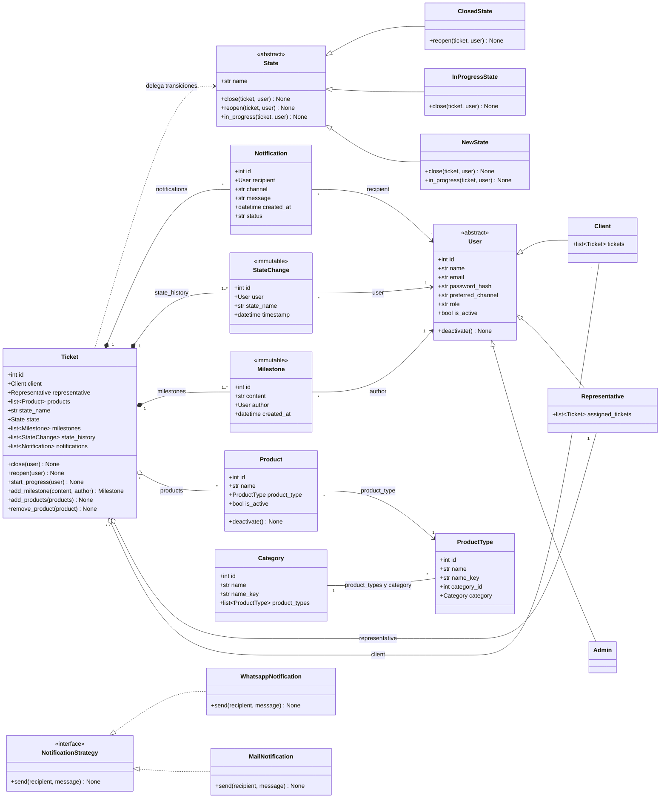

# Diagrama de clases

Versión en Mermaid del diagrama de clases. Se divide en dos vistas para que sea legible:

1. **Modelo de dominio**: entidades, relaciones y los patrones State y Strategy.
2. **Capas de aplicación**: controllers, services y repositories (Controller → Service → Repository).

Los nombres siguen la convención de Python (`snake_case` para atributos y métodos), igual que los [diagramas de secuencia](sequences/).

## 1. Modelo de dominio

### Notas del modelo

- **Patrón State**: los métodos de `State` lanzan `InvalidTransitionError` por defecto, y cada estado concreto sobrescribe solo sus transiciones válidas. En la base solo se persiste `state_name`; la propiedad `state` lo convierte en el objeto `State` correspondiente. Las clases de estado no son entidades mapeadas.

  | Desde | `in_progress` | `close` | `reopen` |
  |-------|---------------|---------|----------|
  | `NewState` | → `InProgress` | → `Closed` | ❌ |
  | `InProgressState` | ❌ | → `Closed` | ❌ |
  | `ClosedState` | ❌ | ❌ | → `InProgress` |

- **Composición** (rombo lleno): `Milestone`, `StateChange` y `Notification` existen solo dentro de un `Ticket` y se crean únicamente a través de sus métodos.
- **Agregación** (rombo vacío): `Client`, `Representative` y `Product` tienen un ciclo de vida independiente del ticket.
- **Inmutables**: `Milestone` y `StateChange` no se pueden modificar ni borrar. Los protegen listeners del ORM y triggers de SQLite (RNF 5 y 6).
- **Baja lógica**: `User` y `Product` tienen `is_active` y nunca se borran físicamente.
- **Catálogo**: `Category` y `ProductType` guardan el `name` sin espacios en los extremos y una columna `name_key = normalize_name(name)` (`strip().casefold()`) que completa un `@validates("name")` común (mixin `CatalogName`). La unicidad sin distinguir mayúsculas la impone la base con `UNIQUE (name_key)` en `categories` y `UNIQUE (category_id, name_key)` en `product_types`. `product_types.category_id` es FK `ON DELETE RESTRICT` y `Category.product_types` usa `passive_deletes="all"` y `order_by=(name_key, id)`: borrar una categoría nunca toca sus tipos, y la base rechaza la baja si tiene alguno. La baja de categorías y tipos es física. `Product` llega en `03-products`.
- **Usuarios**: herencia de tabla única (tabla `users`) con el discriminador `role`; el registro `ROLE_CLASSES` resuelve la subclase a partir del rol. El email se normaliza al asignarlo (`normalize_email`) y `preferred_channel` solo admite `mail` o `whatsapp` (`NOTIFICATION_CHANNELS`). `User` no verifica contraseñas: el dominio solo importa `sqlalchemy`, así que el hash vive en `PasswordHasher` (capa de services).
- **Patrón Strategy**: `NotificationService` elige la estrategia según `recipient.preferred_channel`. Ambas estrategias simulan el envío.

## 2. Capas de aplicación

```mermaid
classDiagram
    direction TB

    class AuthController {
        +login(email, password)
        +logout()
    }
    class UserController {
        +create_user(body)
        +update_user(user_id, body)
        +deactivate_user(user_id)
        +list_clients()
        +list_representatives()
    }
    class auth {
        <<module>>
        +get_user_service() UserService
        +current_user() User
        +authenticated_user() User
        +login_required(view)
        +admin_required(view)
    }
    class errors {
        <<module>>
        +ERROR_RESPONSES dict
        +HTTP_ERROR_RESPONSES dict
        +register_error_handlers(app) None
    }
    class cli {
        <<module>>
        +create_admin(name, email, password)
    }
    class TicketController {
        +create_ticket(client_id, product_ids, first_message)
        +list_tickets()
        +get_ticket(ticket_id)
        +close_ticket(ticket_id)
        +reopen_ticket(ticket_id)
        +add_products(ticket_id, product_ids)
        +remove_product(ticket_id, product_id)
    }
    class MilestoneController {
        +add_milestone(ticket_id, content, start_progress)
        +list_milestones(ticket_id)
    }
    class wiring {
        <<module>>
        +get_catalog_service() CatalogService
    }
    class CatalogController {
        +list_categories()
        +create_category(body)
        +update_category(category_id, body)
        +delete_category(category_id)
        +create_product_type(body)
        +update_product_type(product_type_id, body)
        +delete_product_type(product_type_id)
        +list_product_types(category_id)
        +create_product(name, product_type_id)
        +update_product(product_id, form)
        +deactivate_product(product_id)
        +list_products(filters)
        +list_available_products()
    }

    class UserService {
        +UserRepository repository
        +PasswordHasher hasher
        +Callable commit
        +create_user(name, email, role, password, preferred_channel) User
        +update_user(user_id, name, email, preferred_channel) User
        +deactivate_user(user_id, actor) User
        +authenticate(email, password) User
        +find_active_user(user_id) User
        +list_by_role(role) list
    }
    class PasswordHasher {
        <<interface>>
        +hash(password) str
        +verify(password_hash, password) bool
    }
    class WerkzeugPasswordHasher {
        +hash(password) str
        +verify(password_hash, password) bool
    }
    class TicketService {
        +create_ticket(client_id, product_ids, first_message, representative) Ticket
        +list_tickets(actor) list
        +get_ticket(ticket_id, actor) Ticket
        +close_ticket(ticket_id, actor) Ticket
        +reopen_ticket(ticket_id, actor) Ticket
        +add_milestone(ticket_id, content, actor, start_progress) Milestone
        +list_milestones(ticket_id, actor) list
        +add_products(ticket_id, product_ids, actor) None
        +remove_product(ticket_id, product_id, actor) None
    }
    class CatalogService {
        +CategoryRepository categories
        +ProductTypeRepository product_types
        +Callable commit
        +create_category(name) Category
        +update_category(category_id, name) Category
        +delete_category(category_id) None
        +list_categories() list
        +create_product_type(name, category_id) ProductType
        +update_product_type(product_type_id, name, category_id) ProductType
        +delete_product_type(product_type_id) None
        +list_product_types(category_id) list
    }
    class validation {
        <<module>>
        +text_error(value) str
        +id_error(value) str
        +parse_id(value) int
        +provided(values) dict
        +raise_if_invalid(errors) None
    }
    class ProductService {
        +create_product(name, product_type_id) Product
        +update_product(product_id, data) Product
        +deactivate_product(product_id) None
        +list_products(filters) list
        +list_available_products() list
    }
    class NotificationService {
        +dict strategies
        +notify(recipient, actor, ticket, message) None
    }

    class UserRepository {
        +get(user_id) User
        +find_by_email(email) User
        +list_by_role(role) list
        +add(user) None
    }
    class TicketRepository {
        +get_visible(ticket_id, actor) Ticket
        +list_by_client(client_id) list
        +list_by_representative(rep_id) list
        +add(ticket) None
    }
    class CategoryRepository {
        +add(category) None
        +get(category_id) Category
        +find_by_name(name) Category
        +list_all() list
        +list_with_product_types() list
        +has_product_types(category_id) bool
        +delete(category) None
    }
    class ProductTypeRepository {
        +add(product_type) None
        +get(product_type_id) ProductType
        +find_by_name_in_category(name, category_id) ProductType
        +delete(product_type) None
    }
    class ProductRepository {
        +get_many(product_ids) list
        +list(filters) list
    }
    class NotificationRepository {
        +add(notification) None
    }

    AuthController --> auth
    UserController --> auth
    cli --> auth
    auth --> UserService
    AuthController ..> errors : DomainError a HTTP
    UserController ..> errors : DomainError a HTTP
    TicketController --> TicketService
    MilestoneController --> TicketService
    CatalogController --> wiring
    CatalogController --> auth : login_required y admin_required
    CatalogController ..> errors : DomainError a HTTP
    wiring --> CatalogService
    CatalogService ..> validation
    UserService ..> validation
    CatalogController --> ProductService

    UserService --> UserRepository
    UserService --> PasswordHasher
    PasswordHasher <|.. WerkzeugPasswordHasher
    TicketService --> TicketRepository
    TicketService --> UserRepository
    TicketService --> ProductRepository
    TicketService --> NotificationService
    CatalogService --> CategoryRepository
    CatalogService --> ProductTypeRepository
    ProductService --> ProductRepository
    ProductService --> ProductTypeRepository
    NotificationService --> NotificationRepository
    NotificationService --> NotificationStrategy
```

### Notas de las capas

- Los **controllers** solo traducen HTTP: validan la entrada, obtienen `current_user` de la sesión y convierten las excepciones de dominio en códigos HTTP.
- Los **services** reciben sus dependencias por constructor (repositorios, `NotificationService`, un `clock` inyectable y la función `commit`, que en producción es `session.commit`) y deciden cuándo confirmar la transacción. `UserService` recibe además un `PasswordHasher`.
- `app/auth.py` arma `UserService` para cada request (o comando CLI) y expone `current_user()` y los decoradores `login_required` (`401`) y `admin_required` (`403`). `app/controllers/errors.py` traduce cada `DomainError` a su status y código JSON con una tabla, y con una segunda tabla (`HTTP_ERROR_RESPONSES`) responde en JSON las rutas inexistentes (`404` `not_found`), los métodos no admitidos (`405` `method_not_allowed`) y los errores no manejados (`500` `internal_error`, registrado sobre `InternalServerError` para que el teardown siga haciendo rollback). El comando `create-admin` (`app/cli.py`) reutiliza `create_user`.
- Los **repositories** encapsulan la `Session` de SQLAlchemy y nunca hacen commit. `UserRepository.add` hace `flush()` y traduce el `IntegrityError` del email único a `DuplicateUserError`, y `UserRepository.get` devuelve `None` para un id fuera del `INTEGER` de SQLite (`fits_integer_column`). `TicketRepository.get_visible` aplica el filtro de privacidad (RNF 4).
- `app/wiring.py` arma `CatalogService` para cada request con `get_session()` y los dos repositorios del catálogo, así los controllers nunca tocan la `Session`. `app/services/validation.py` reúne los validadores de campos que comparten `UserService` y `CatalogService` (`text_error`, `id_error`, `parse_id`, `provided`, `raise_if_invalid`).
- `CategoryRepository.add` y `ProductTypeRepository.add` hacen `flush()` y traducen el `IntegrityError` de los `UNIQUE` a `DuplicateCategoryError` y `DuplicateProductTypeError`. `CategoryRepository.delete` traduce el de la FK `RESTRICT` a `CategoryInUseError`. `list_with_product_types` carga las categorías con `selectinload(Category.product_types)` (2 consultas en total). Los dos `get` devuelven `None` para un id que no entra en el `INTEGER` de SQLite (`fits_integer_column` de `app/db.py`).
- No hay `MilestoneService`: los hitos forman parte del agregado `Ticket` y se gestionan desde `TicketService`.
