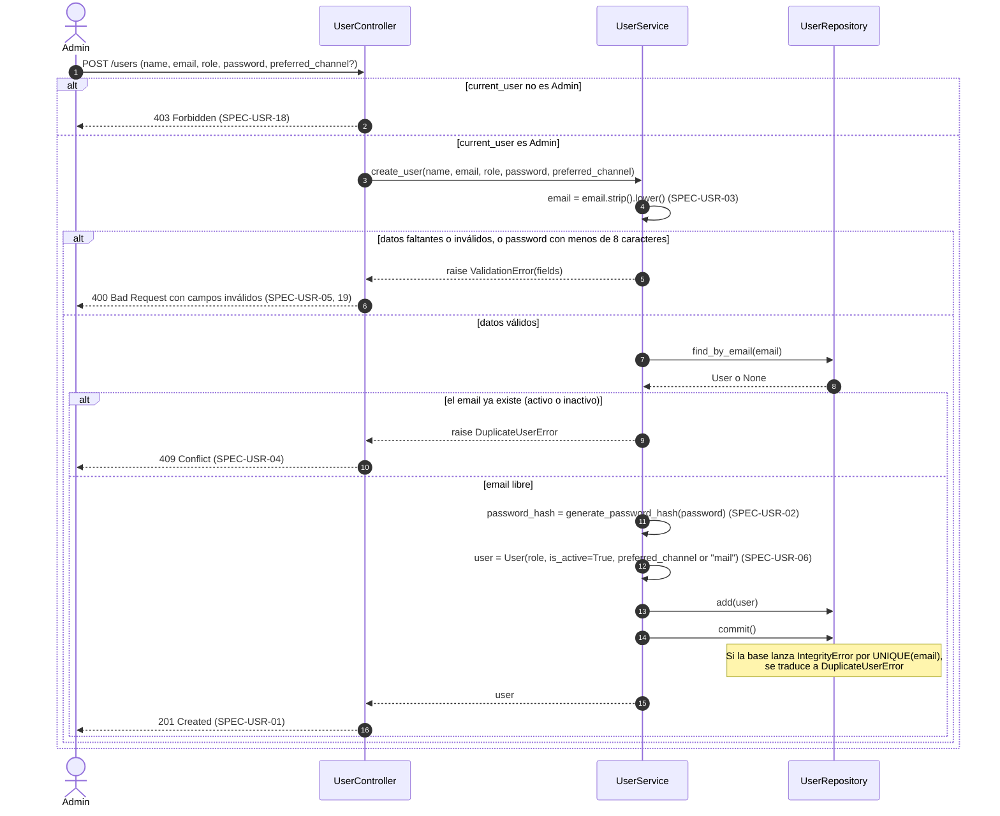
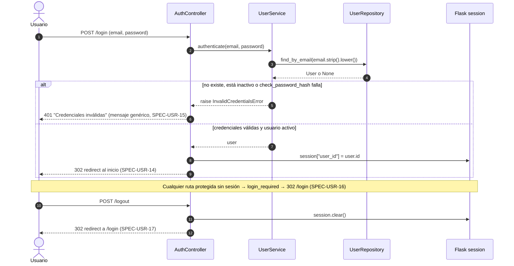
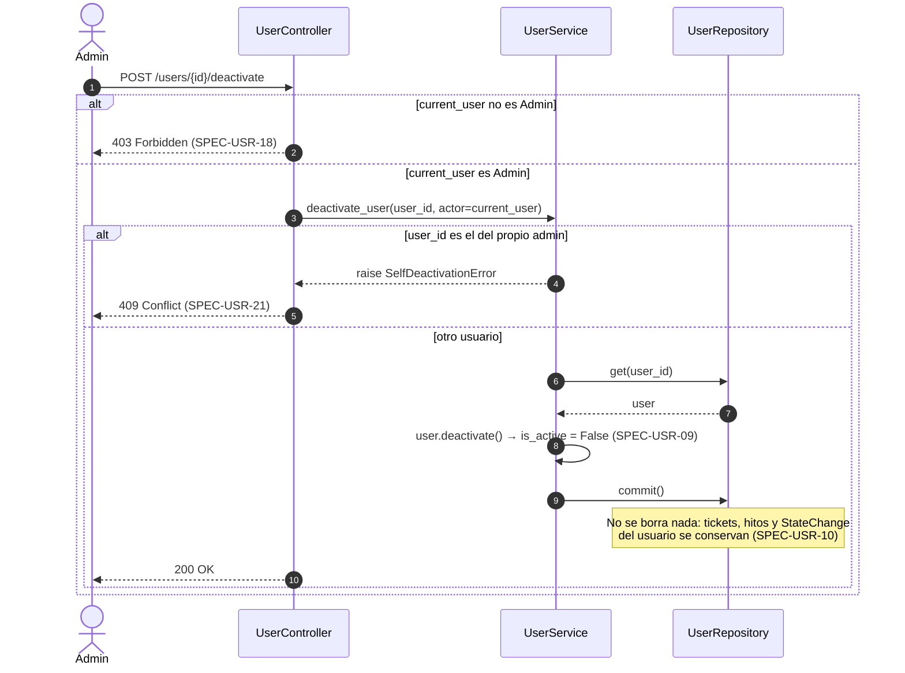
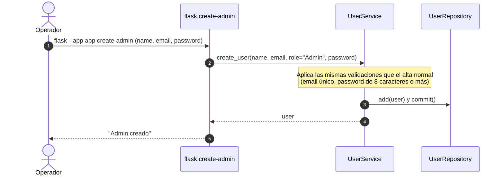

# Secuencias — 01 Usuarios y accesos

Spec: [specs/01-users/spec.md](../../specs/01-users/spec.md)

## 1. Alta de usuario

Specs: SPEC-USR-01, 02, 03, 04, 05, 06, 18, 19

## 2. Login y logout

Specs: SPEC-USR-14, 15, 16, 17

## 3. Baja lógica de usuario

Specs: SPEC-USR-09, 10, 18, 21

## 4. Creación del primer administrador (CLI)

Specs: SPEC-USR-20

