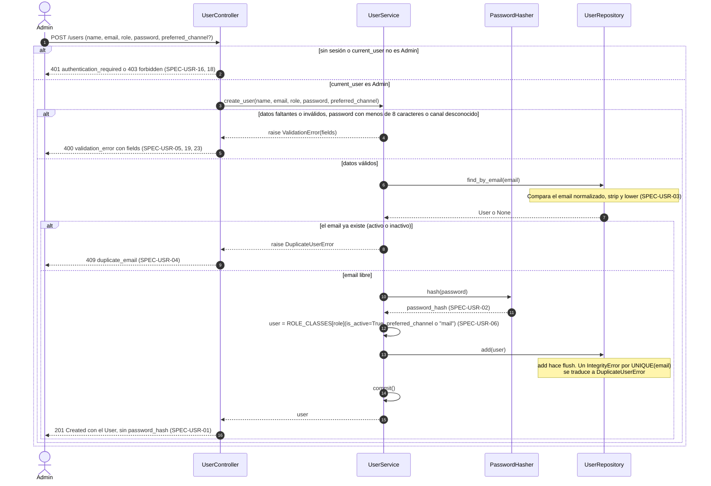
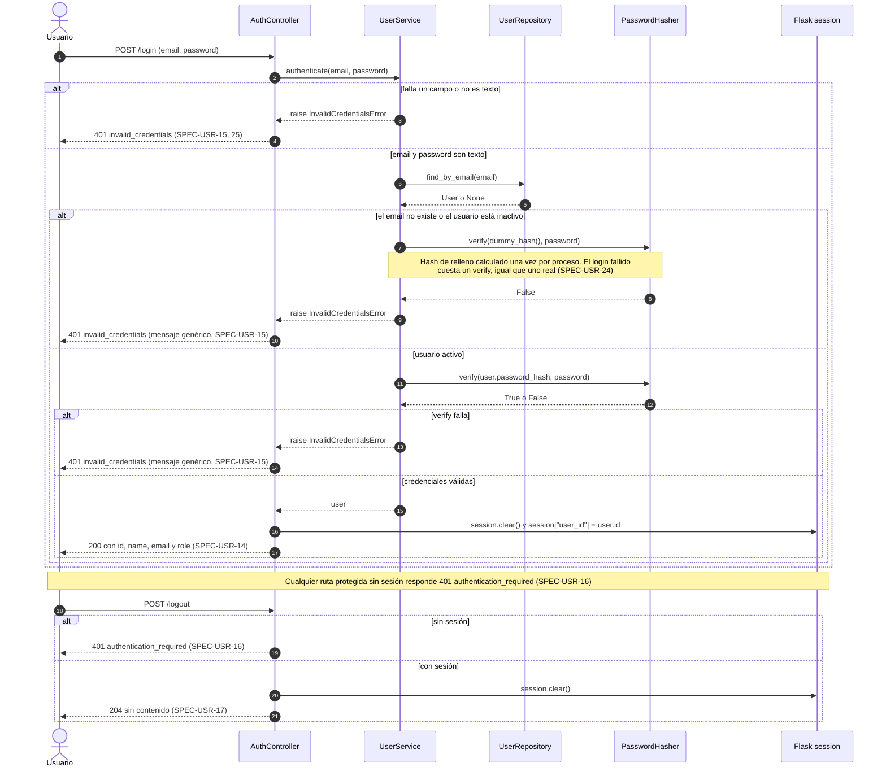
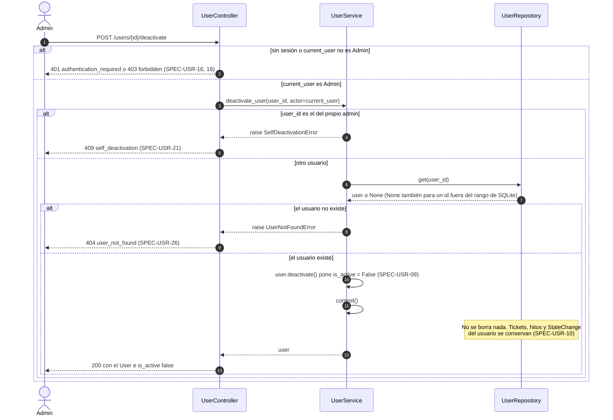
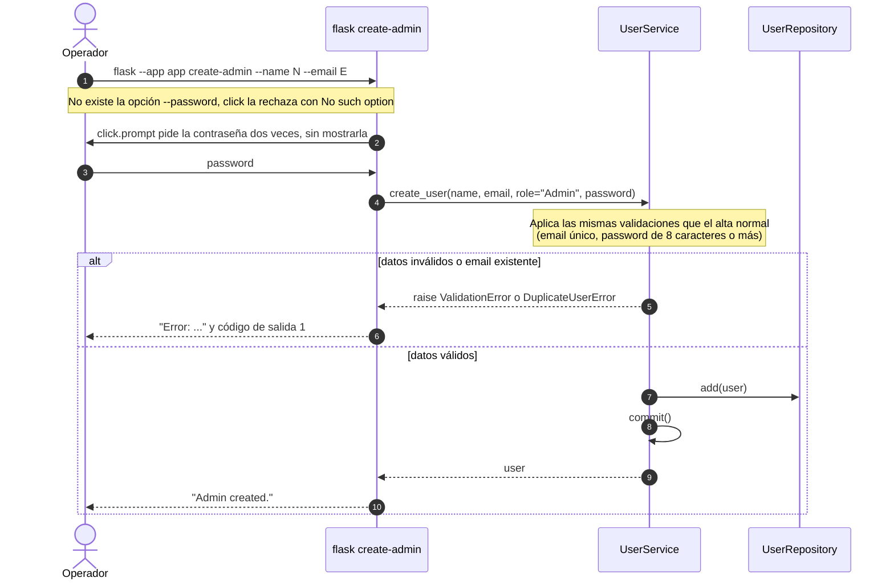
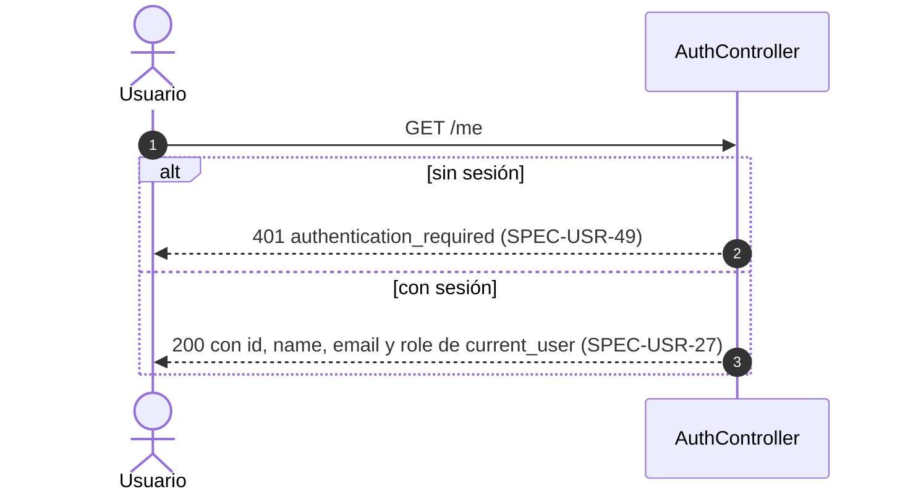
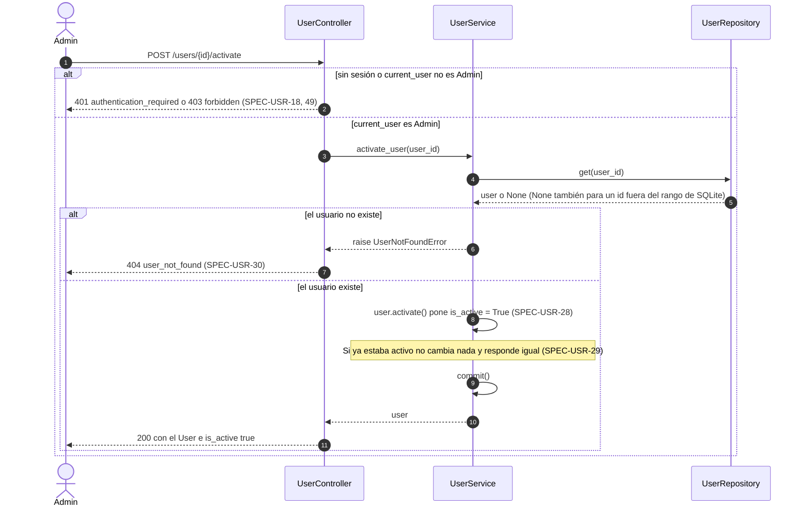
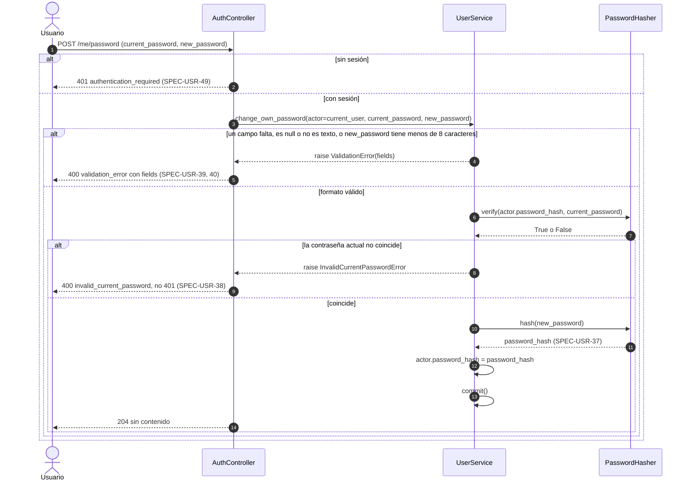
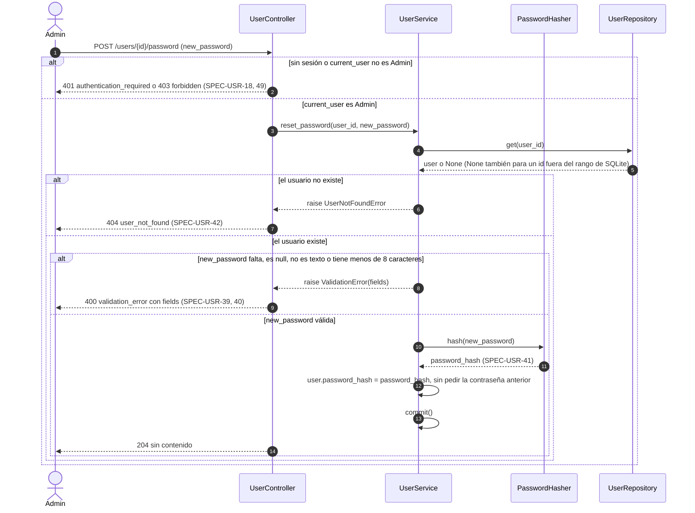
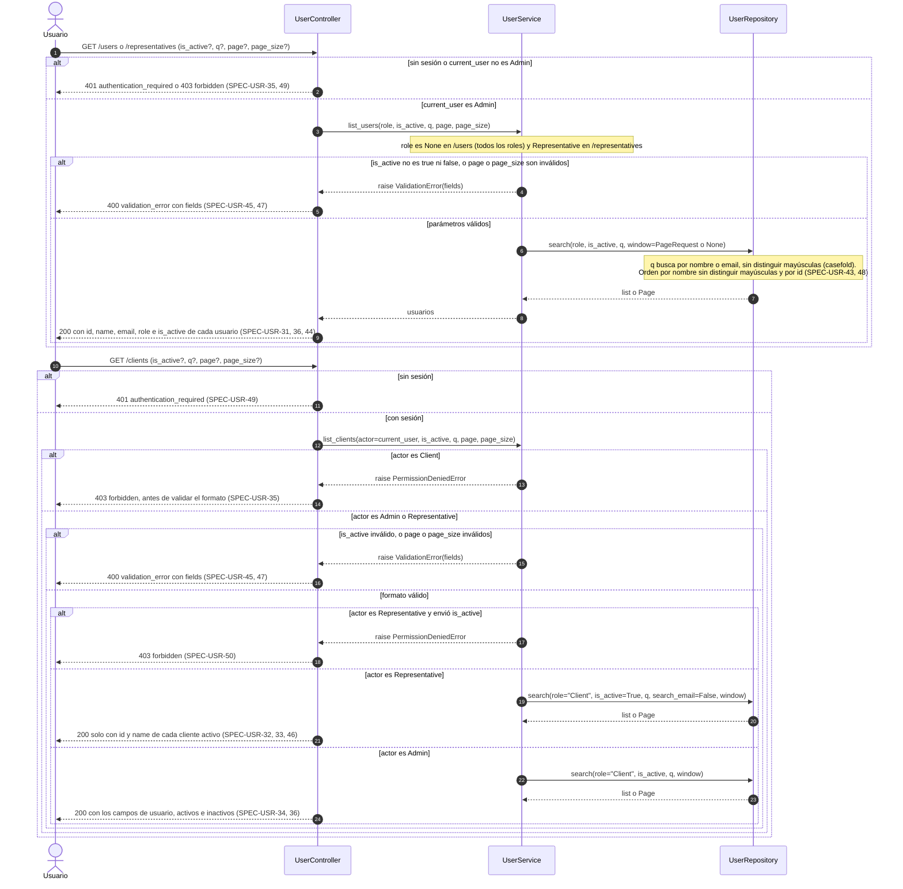

# Secuencias — 01 Usuarios y accesos

Spec: [specs/01-users/spec.md](../../specs/01-users/spec.md)

Convenciones comunes a todos los diagramas:

- `UserService` recibe por constructor el repositorio, un `PasswordHasher` y la función `commit` (en producción, `session.commit`). El repositorio nunca hace commit.
- Las excepciones de dominio llegan a `register_error_handlers`, que las traduce a JSON con una tabla: `ValidationError` e `InvalidCurrentPasswordError` → `400`, `InvalidCredentialsError` → `401`, `PermissionDeniedError` → `403`, `UserNotFoundError` → `404`, `DuplicateUserError` y `SelfDeactivationError` → `409`. Una ruta o un método que la API no expone responde `404` `not_found` o `405` `method_not_allowed` (SPEC-PLT-15) y un error no manejado `500` `internal_error` (SPEC-PLT-16).
- `login_required` responde `401` `authentication_required` sin sesión (SPEC-USR-49). `admin_required` lo responde igual y `403` `forbidden` si el usuario no es `Admin`. Un usuario inexistente o inactivo cuenta como sin sesión.

## 1. Alta de usuario

Specs: SPEC-USR-01, 02, 03, 04, 05, 06, 18, 19, 23

## 2. Login y logout

Specs: SPEC-USR-14, 15, 16, 17, 24, 25

## 3. Baja lógica de usuario

Specs: SPEC-USR-09, 10, 18, 21

## 4. Creación del primer administrador (CLI)

Specs: SPEC-USR-20

## 5. Identidad de la sesión (GET /me)

Specs: SPEC-USR-27, 49

## 6. Reactivación de usuario

Specs: SPEC-USR-18, 28, 29, 30

## 7. Cambio de la contraseña propia

Specs: SPEC-USR-37, 38, 39, 40, 49

## 8. Restablecimiento de la contraseña de otro usuario

Specs: SPEC-USR-18, 39, 40, 41, 42

## 9. Listados de usuarios, clientes y representantes

Specs: SPEC-USR-31, 32, 33, 34, 35, 36, 43, 44, 45, 46, 47, 48, 50

