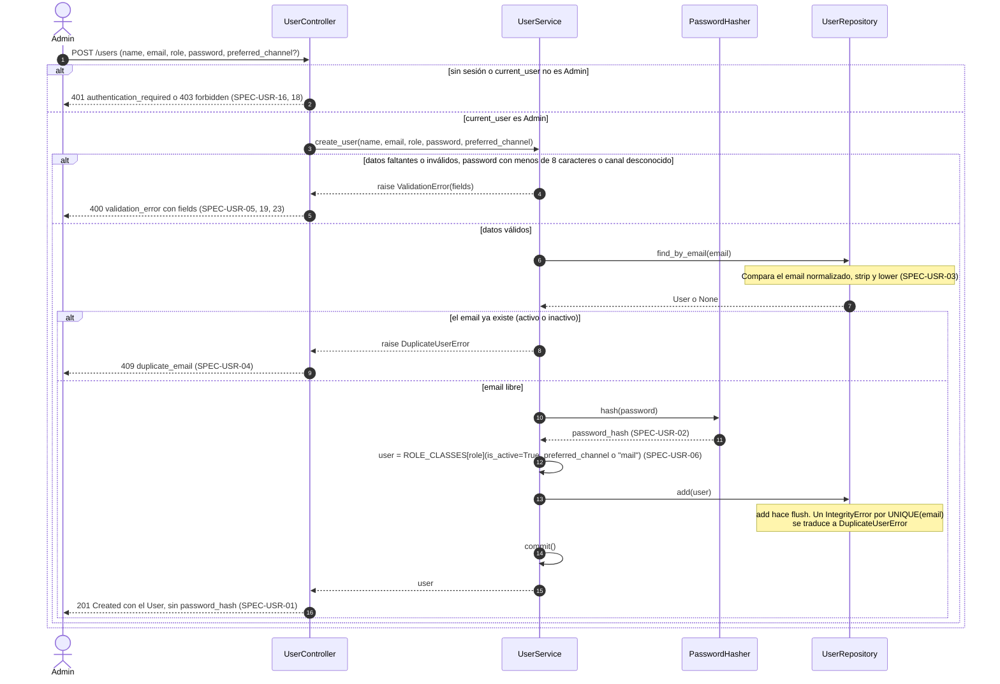
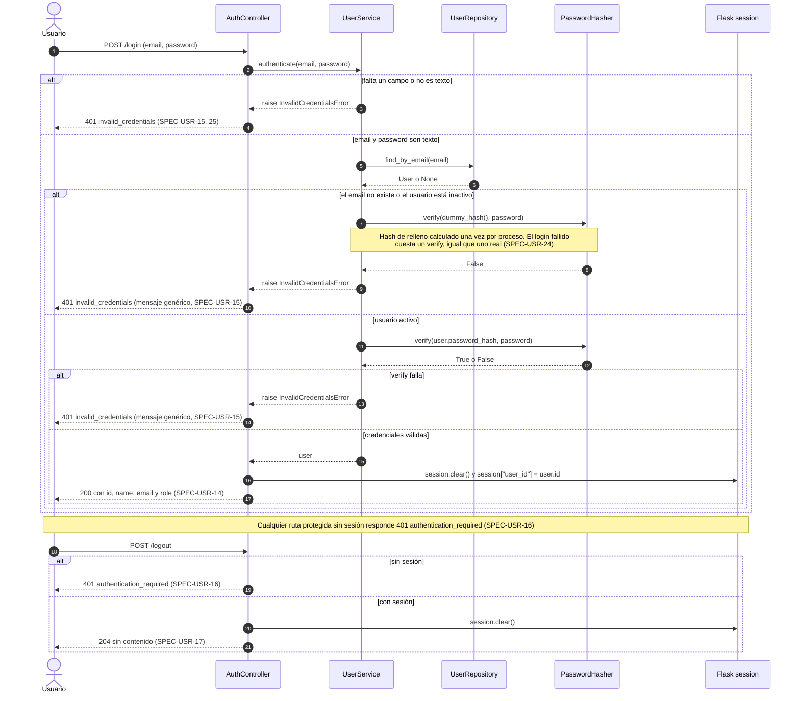
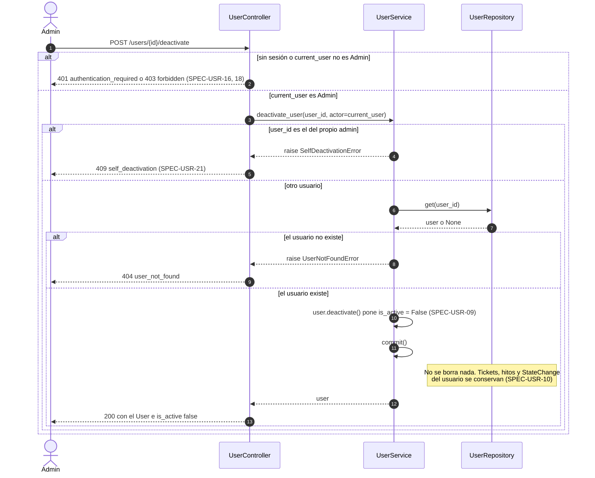
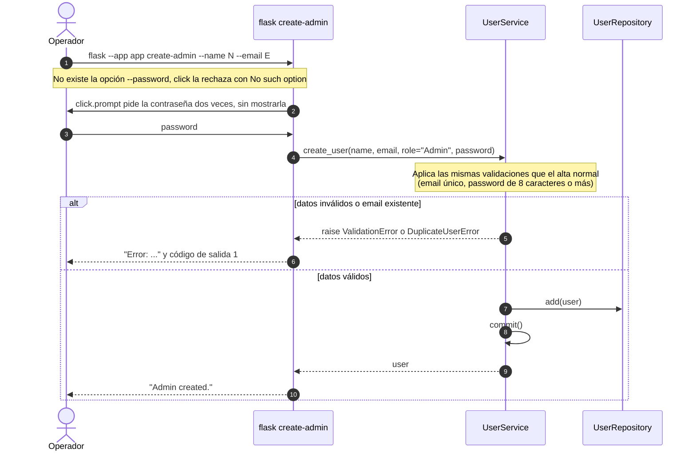

# Secuencias — 01 Usuarios y accesos

Spec: [specs/01-users/spec.md](../../specs/01-users/spec.md)

Convenciones comunes a los cuatro diagramas:

- `UserService` recibe por constructor el repositorio, un `PasswordHasher` y la función `commit` (en producción, `session.commit`). El repositorio nunca hace commit.
- Las excepciones de dominio llegan a `register_error_handlers`, que las traduce a JSON con una tabla: `ValidationError` → `400`, `InvalidCredentialsError` → `401`, `UserNotFoundError` → `404`, `DuplicateUserError` y `SelfDeactivationError` → `409`.
- `admin_required` responde `401` `authentication_required` sin sesión y `403` `forbidden` si el usuario no es `Admin`. Un usuario inexistente o inactivo cuenta como sin sesión.

## 1. Alta de usuario

Specs: SPEC-USR-01, 02, 03, 04, 05, 06, 18, 19, 23

## 2. Login y logout

Specs: SPEC-USR-14, 15, 16, 17, 24, 25

## 3. Baja lógica de usuario

Specs: SPEC-USR-09, 10, 18, 21

## 4. Creación del primer administrador (CLI)

Specs: SPEC-USR-20

