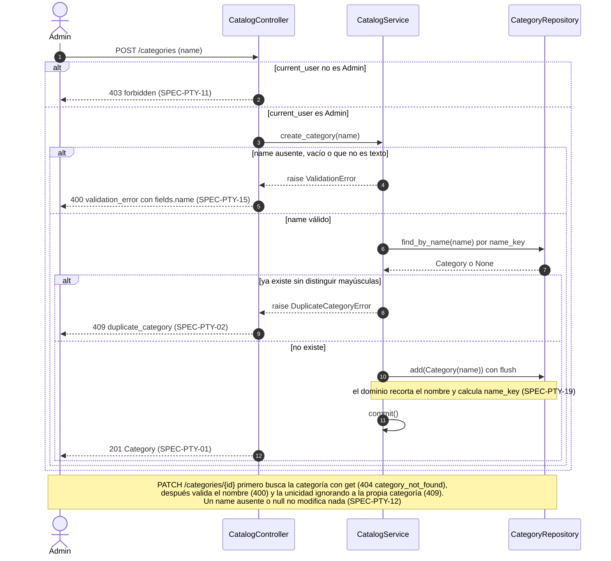
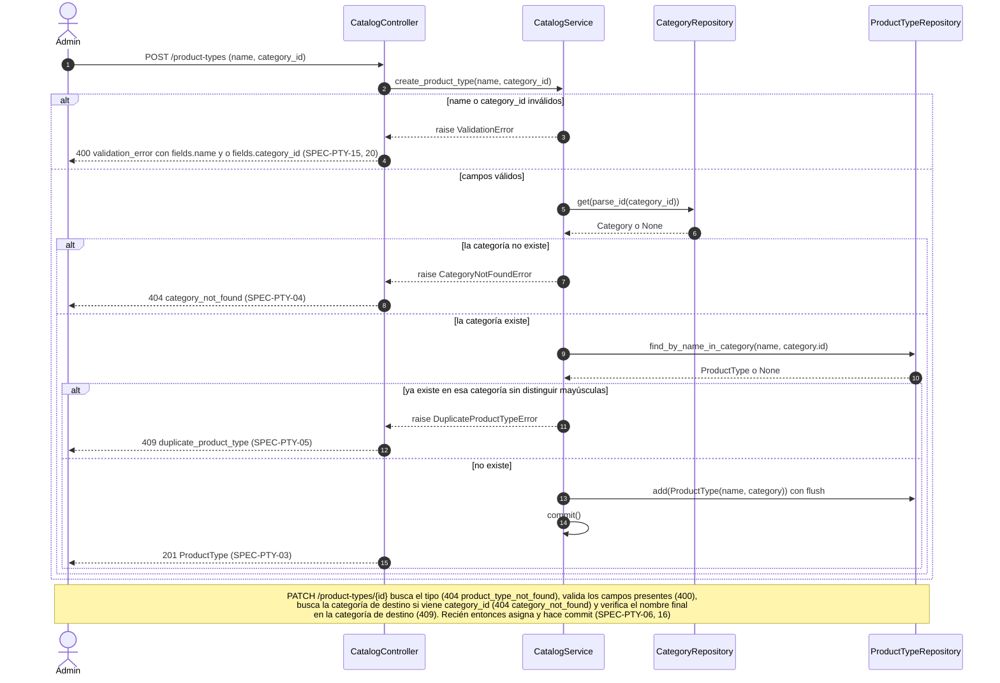
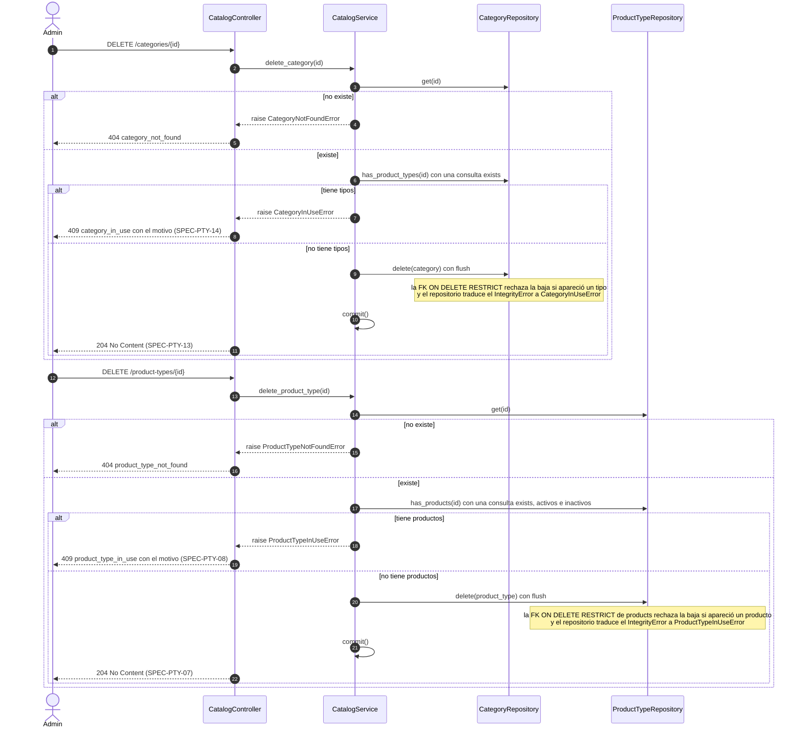

# Secuencias — 02 Tipos de producto y rubros

Spec: [specs/02-product-types/spec.md](../../specs/02-product-types/spec.md)

En todos los flujos de escritura, si `current_user` no es `Admin`, `admin_required` responde 403 (SPEC-PTY-11), y sin sesión `login_required` responde 401. Para no repetirlo, solo se muestra en el primer diagrama. El controller obtiene el service con `get_catalog_service()` (`app/wiring.py`), que lo arma con los repositorios y `commit = session.commit`. Las excepciones de dominio se traducen a HTTP con la tabla de `app/controllers/errors.py`.

## 1. Alta y modificación de categoría

Specs: SPEC-PTY-01, 02, 11, 12, 15, 19



## 2. Alta y modificación de tipo de producto

Specs: SPEC-PTY-03, 04, 05, 06, 15, 16, 19, 20



## 3. Baja de categoría o de tipo de producto

Specs: SPEC-PTY-07, 08, 13, 14 (SPEC-PTY-08 se implementó en `03-products`)



## 4. Listados de categorías y de tipos por categoría, con búsqueda `q`

Specs: SPEC-PTY-10, 17, 18, 20, 21, 22, 23, 24 (SPEC-PTY-09 la reemplaza SPEC-PTY-22)

Ninguno de los dos listados se pagina: `page` y `page_size` se ignoran (SPEC-PTY-24). `search_text(q)` devuelve `None` si `q` falta o es solo espacios, y entonces el listado se comporta como sin `q`.

```mermaid
sequenceDiagram
    autonumber
    actor U as Usuario autenticado
    participant PC as CatalogController
    participant CS as CatalogService
    participant CR as CategoryRepository
    participant TR as ProductTypeRepository

    U->>PC: GET /categories con q opcional
    PC->>CS: list_categories(q)
    CS->>CR: list_all(search_text(q))
    Note over CR: con q filtra por name_key que contiene q.casefold(),<br/>sin q devuelve todas; ordena por name_key e id
    CR-->>CS: categorías
    PC-->>U: 200 lista de Category (SPEC-PTY-17, 21)

    U->>PC: GET /product-types con category_id y q opcionales
    PC->>CS: list_product_types(category_id, q)
    alt category_id que no es un entero positivo
        CS-->>PC: raise ValidationError
        PC-->>U: 400 validation_error con fields.category_id (SPEC-PTY-20)
    else category_id ausente o válido
        opt category_id presente
            CS->>CR: get(parse_id(category_id))
            alt la categoría no existe
                CS-->>PC: raise CategoryNotFoundError
                PC-->>U: 404 category_not_found (SPEC-PTY-18)
            end
        end
        alt q presente
            CS->>TR: search(q, category_id)
            Note over TR: join con la categoría, filtra por name_key y ordena por categoría y tipo;<br/>CS agrupa con _group y omite las categorías sin coincidencias
            TR-->>CS: tipos coincidentes
            PC-->>U: 200 lista de CategoryGroup con coincidencias (SPEC-PTY-23)
        else sin q y sin category_id
            CS->>CR: list_with_product_types()
            Note over CR: select de categories con selectinload de product_types:<br/>2 consultas, incluye las categorías sin tipos
            CR-->>CS: categorías con sus tipos ordenados por nombre
            PC-->>U: 200 lista de CategoryGroup (SPEC-PTY-22)
        else sin q y con category_id
            PC-->>U: 200 lista con un solo grupo (SPEC-PTY-10)
        end
    end
```
