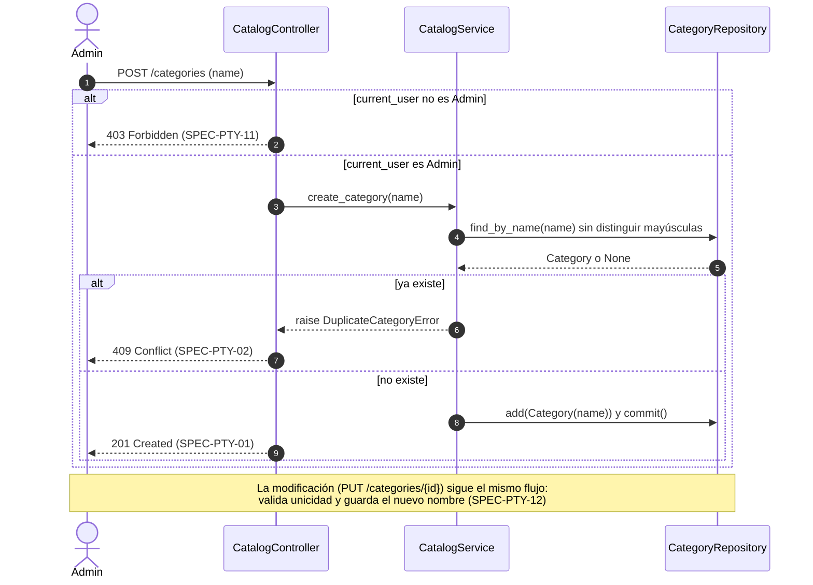
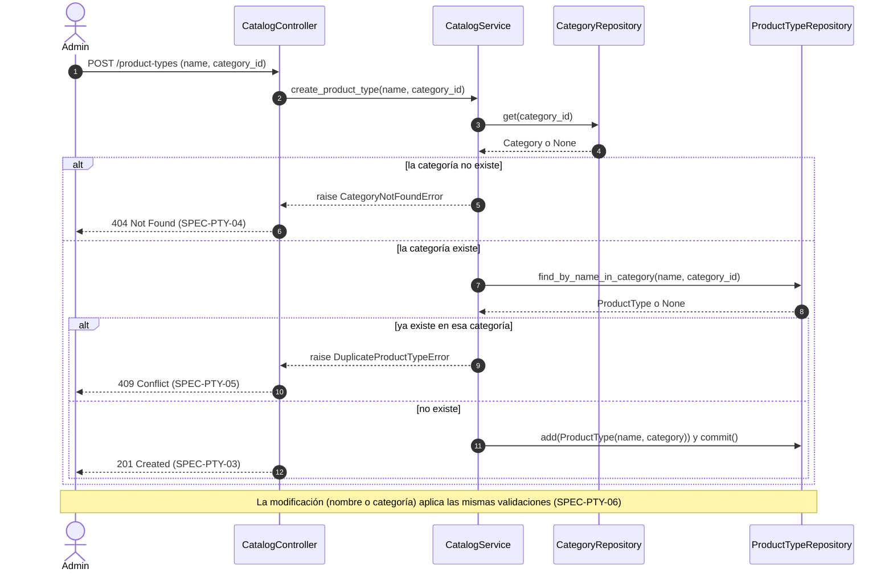
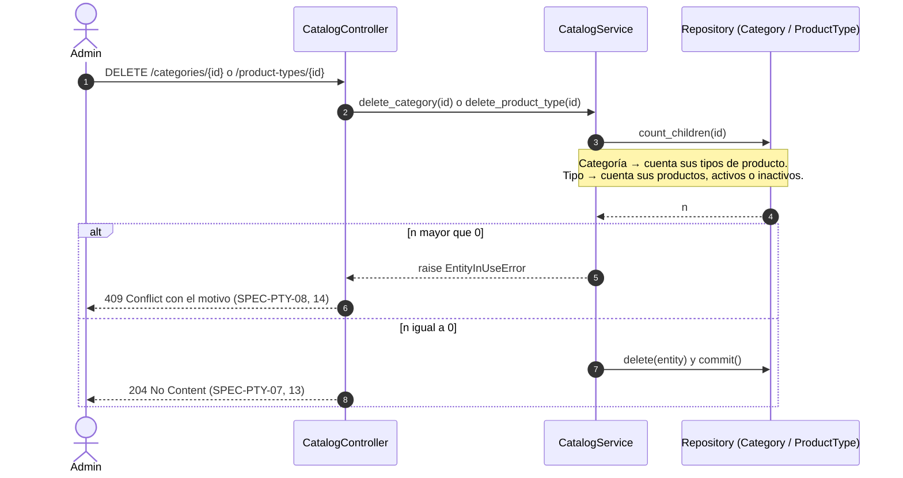
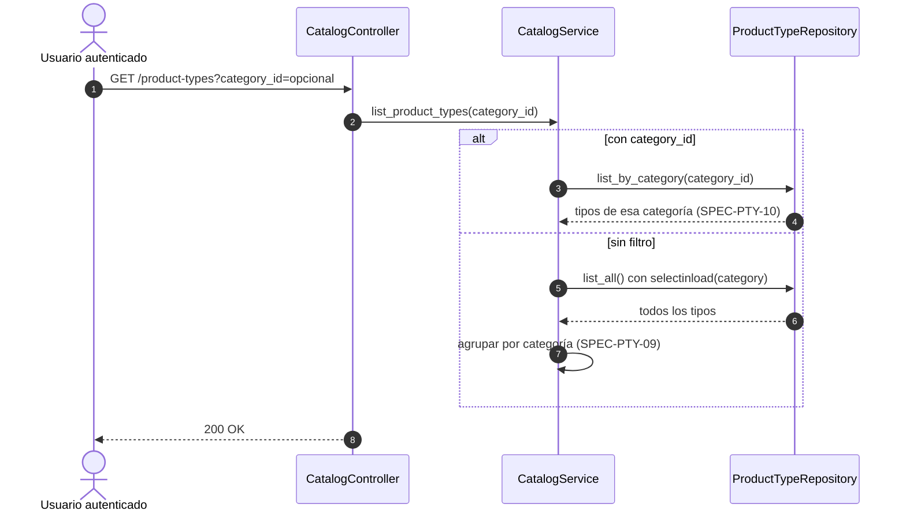

# Secuencias — 02 Tipos de producto y rubros

Spec: [specs/02-product-types/spec.md](../../specs/02-product-types/spec.md)

En todos los flujos de escritura, si `current_user` no es `Admin`, el controller responde 403 (SPEC-PTY-11). Para no repetirlo, solo se muestra en el primer diagrama.

## 1. Alta y modificación de categoría

Specs: SPEC-PTY-01, 02, 11, 12

## 2. Alta de tipo de producto

Specs: SPEC-PTY-03, 04, 05, 06

## 3. Baja de categoría o de tipo de producto

Specs: SPEC-PTY-07, 08, 13, 14

## 4. Listado de tipos por categoría

Specs: SPEC-PTY-09, 10

