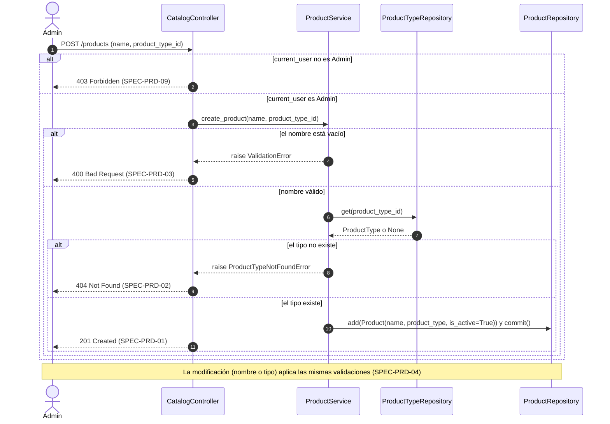
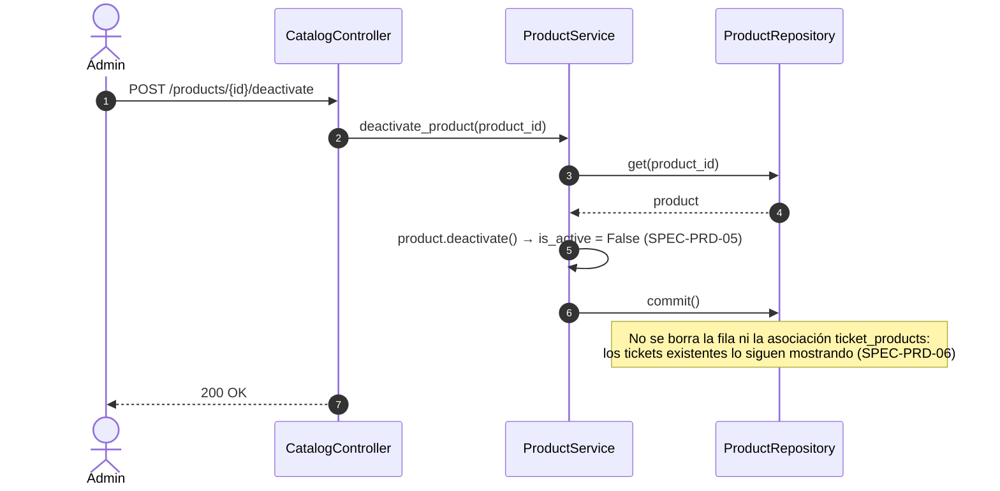
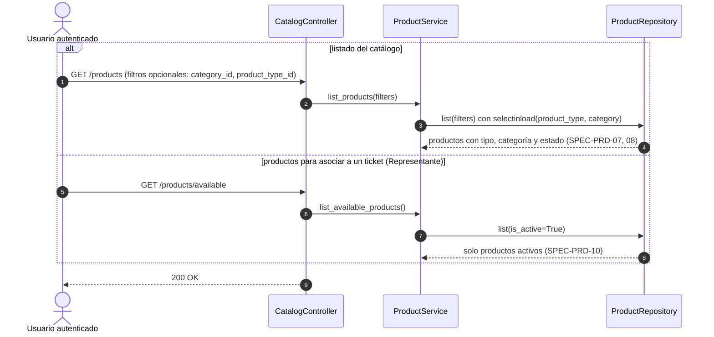

# Secuencias — 03 Productos

Spec: [specs/03-products/spec.md](../../specs/03-products/spec.md)

En todos los flujos de escritura, si `current_user` no es `Admin`, el controller responde 403 (SPEC-PRD-09).

## 1. Alta y modificación de producto

Specs: SPEC-PRD-01, 02, 03, 04, 09

## 2. Baja lógica de producto

Specs: SPEC-PRD-05, 06

## 3. Listados de productos

Specs: SPEC-PRD-07, 08, 10

