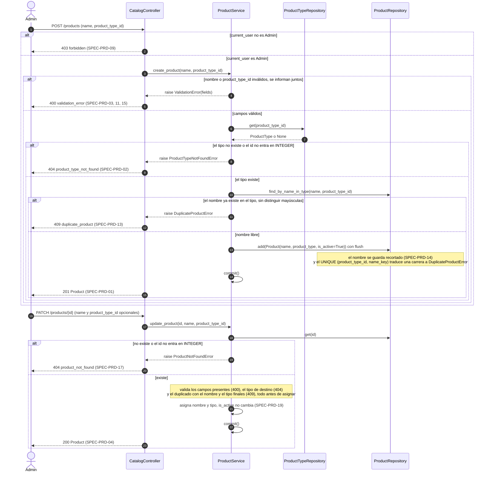
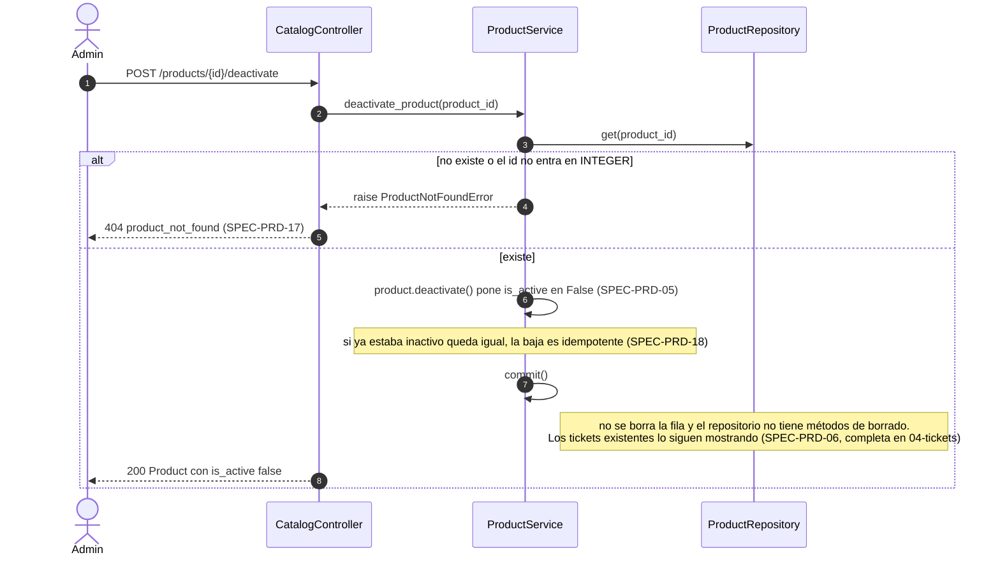
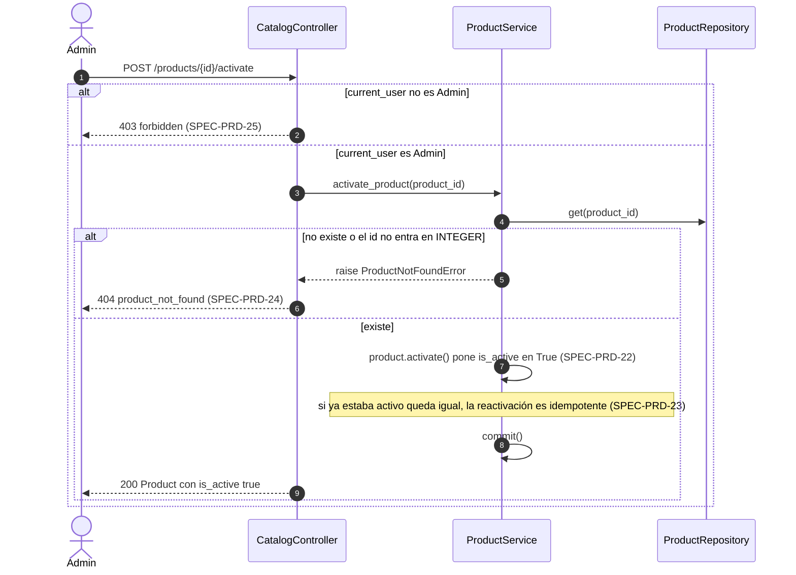
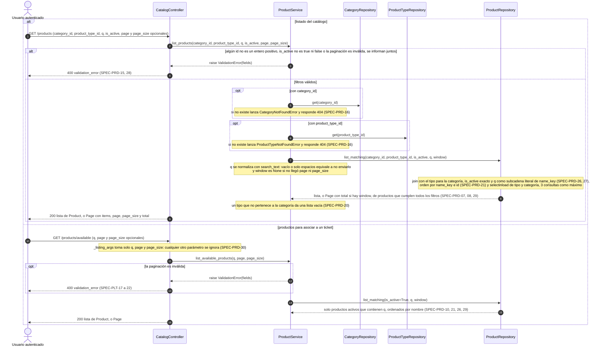

# Secuencias — 03 Productos

Spec: [specs/03-products/spec.md](../../specs/03-products/spec.md)

En todos los flujos de escritura, si `current_user` no es `Admin`, `admin_required` responde 403 antes de llegar al controller (SPEC-PRD-09). Sin sesión, todas las rutas responden 401. El controller arma el service con `get_product_service()` de `app/wiring.py` y traduce cada `DomainError` con `ERROR_RESPONSES`.

## 1. Alta y modificación de producto

Specs: SPEC-PRD-01, 02, 03, 04, 09, 11, 12, 13, 14, 15, 17, 19

## 2. Baja lógica de producto

Specs: SPEC-PRD-05, 06, 09, 17, 18

## 3. Reactivación de producto

Specs: SPEC-PRD-22, 23, 24, 25

## 4. Listados de productos

Specs: SPEC-PRD-07, 08, 10, 15, 16, 20, 21, 26, 27, 28, 29, 30

