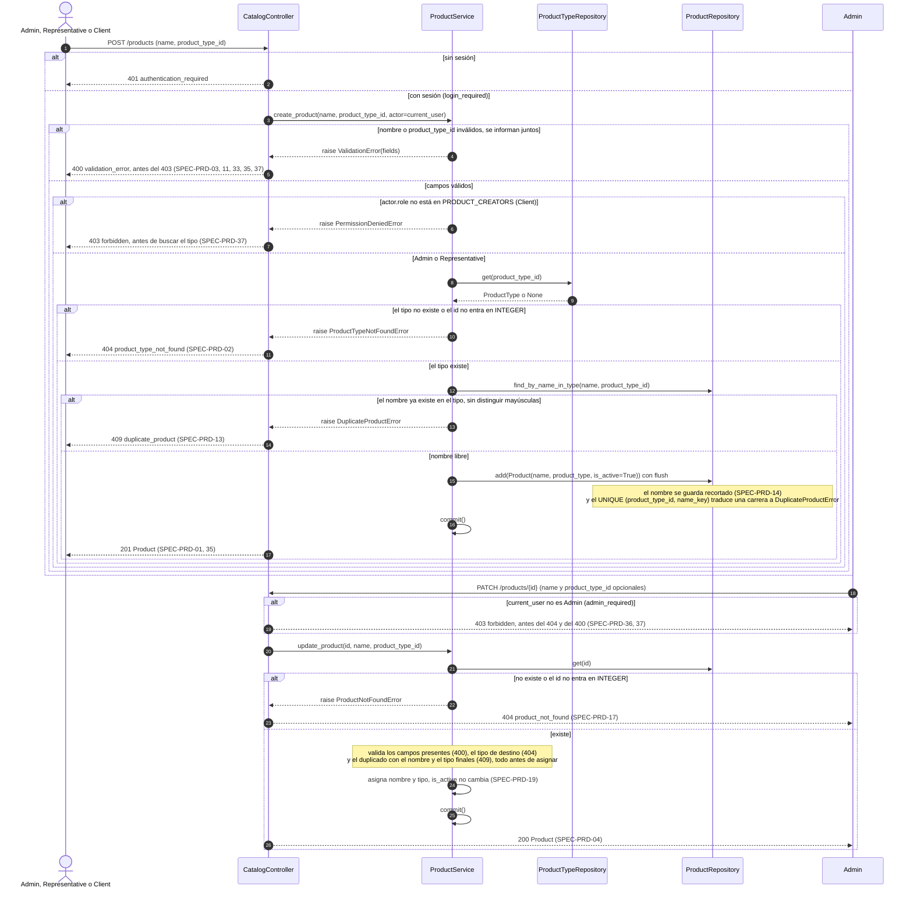
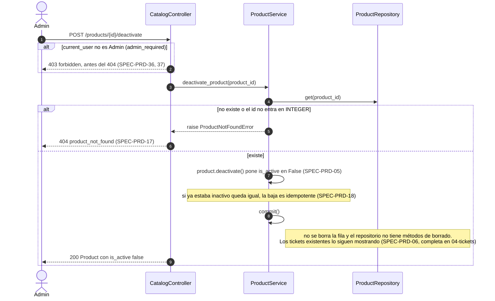
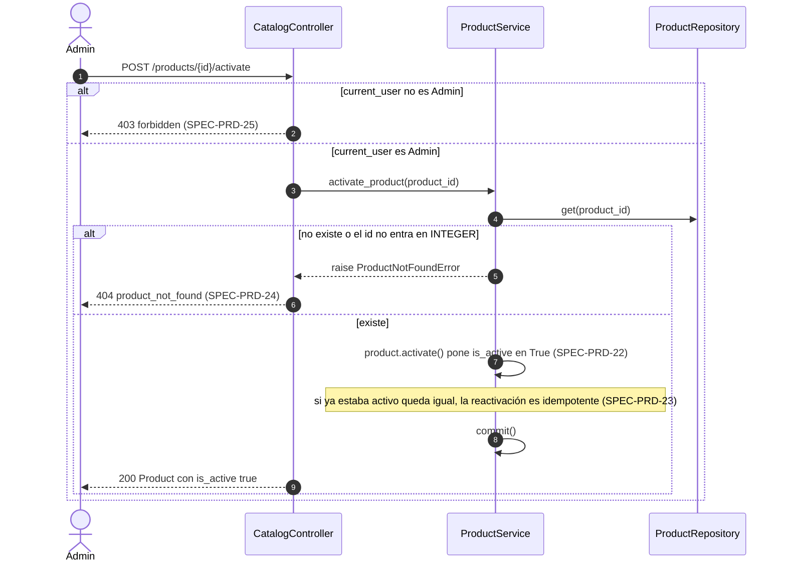
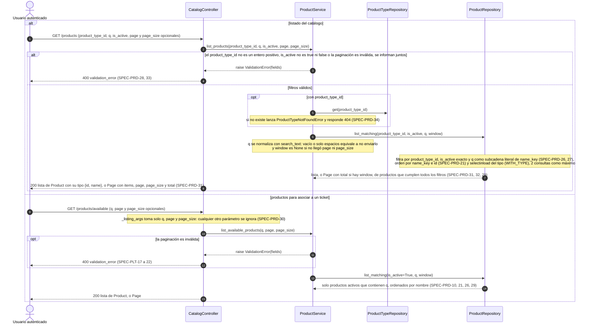

# Secuencias — 03 Productos

Spec: [specs/03-products/spec.md](../../specs/03-products/spec.md)

`POST /products` usa `login_required` y pasa `actor` al service: un `Admin` o un `Representative` lo ejecutan y un `Client` recibe 403 después del 400 de formato y antes del 404 y del 409 (SPEC-PRD-35, 37). `PATCH`, la baja y la reactivación usan `admin_required`: todo no-`Admin` recibe 403 antes de buscar el producto y de leer el cuerpo (SPEC-PRD-36, 37). Sin sesión, todas las rutas responden 401. El controller arma el service con `get_product_service()` de `app/wiring.py` y traduce cada `DomainError` con `ERROR_RESPONSES`.

## 1. Alta y modificación de producto

Specs: SPEC-PRD-01, 02, 03, 04, 11, 12, 13, 14, 17, 19, 33, 35, 36, 37

## 2. Baja lógica de producto

Specs: SPEC-PRD-05, 06, 17, 18, 36, 37

## 3. Reactivación de producto

Specs: SPEC-PRD-22, 23, 24, 25

## 4. Listados de productos

Specs: SPEC-PRD-10, 21, 26, 27, 28, 29, 30, 31, 32, 33, 34

