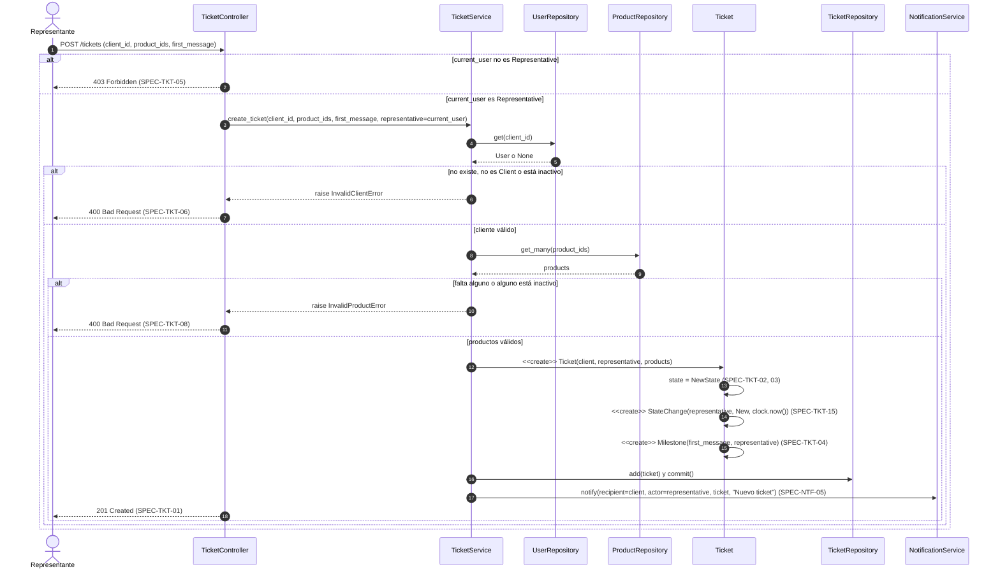
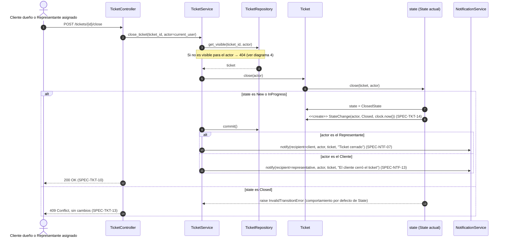
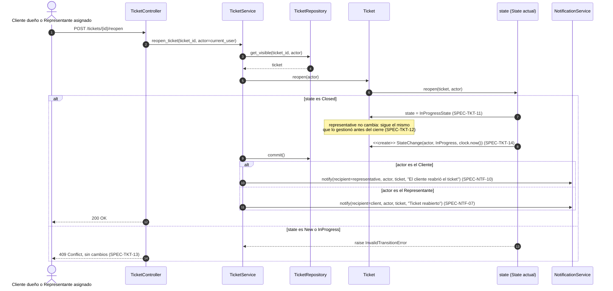
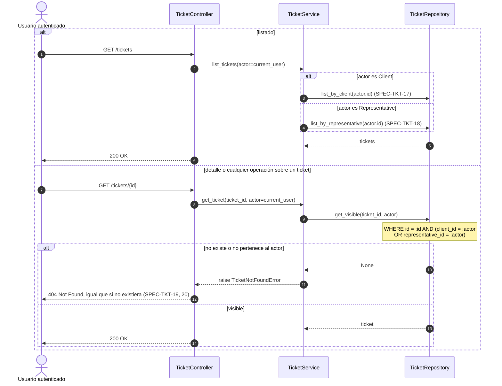
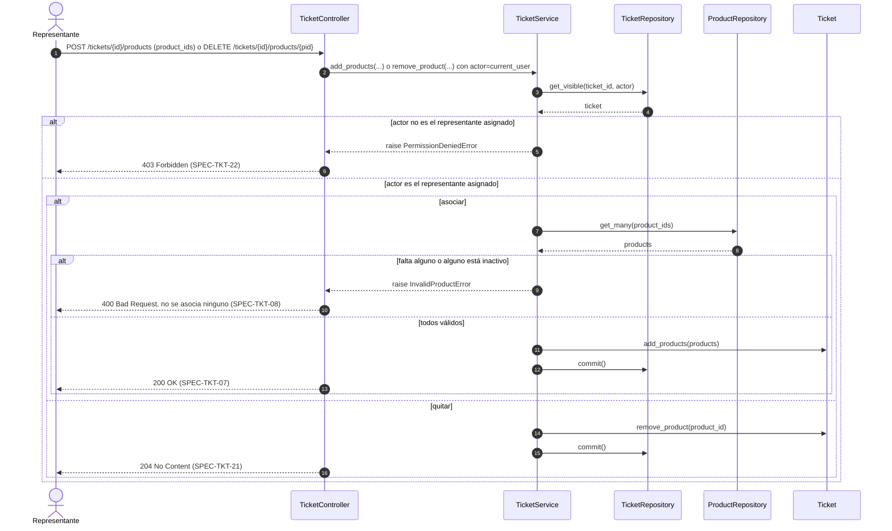

# Secuencias — 04 Ciclo de vida del ticket

Spec: [specs/04-tickets/spec.md](../../specs/04-tickets/spec.md)

Convención de transacción: el service hace `commit()` de la operación del ticket **antes** de notificar. Así, si falla una notificación, el cambio no se revierte (SPEC-NTF-04). El detalle del envío está en [06-notifications.md](06-notifications.md).

## 1. Creación de ticket

Specs: SPEC-TKT-01, 02, 03, 04, 05, 06, 08, 15 · SPEC-NTF-05

## 2. Cierre de ticket (patrón State)

Specs: SPEC-TKT-10, 13, 14 · SPEC-NTF-07, 13

## 3. Reapertura de ticket

Specs: SPEC-TKT-11, 12, 13, 14 · SPEC-NTF-07, 10

## 4. Acceso y privacidad

Specs: SPEC-TKT-17, 18, 19, 20

## 5. Asociar y quitar productos

Specs: SPEC-TKT-07, 08, 21, 22

