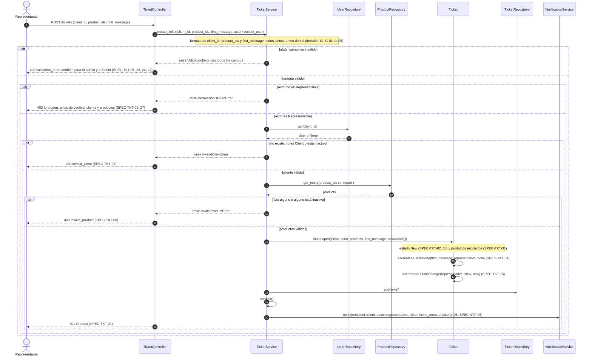
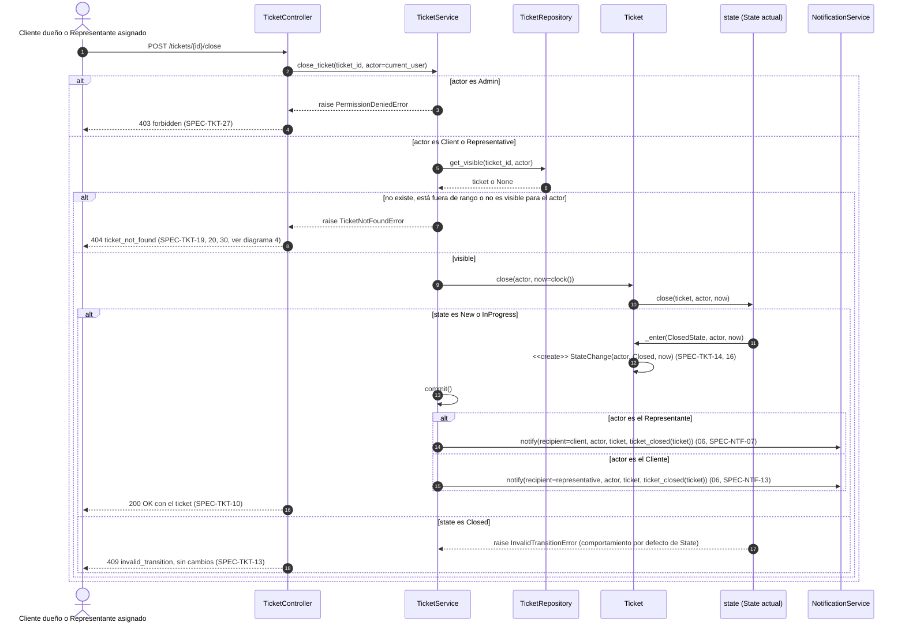
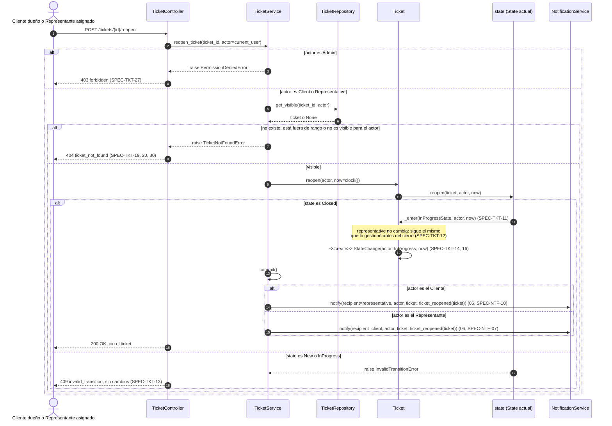
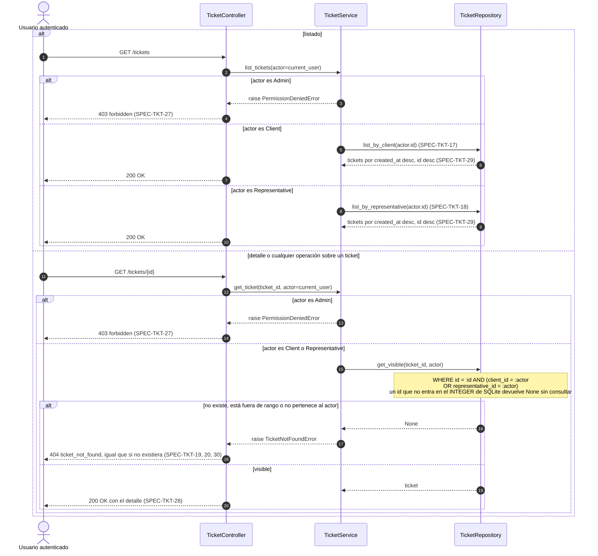
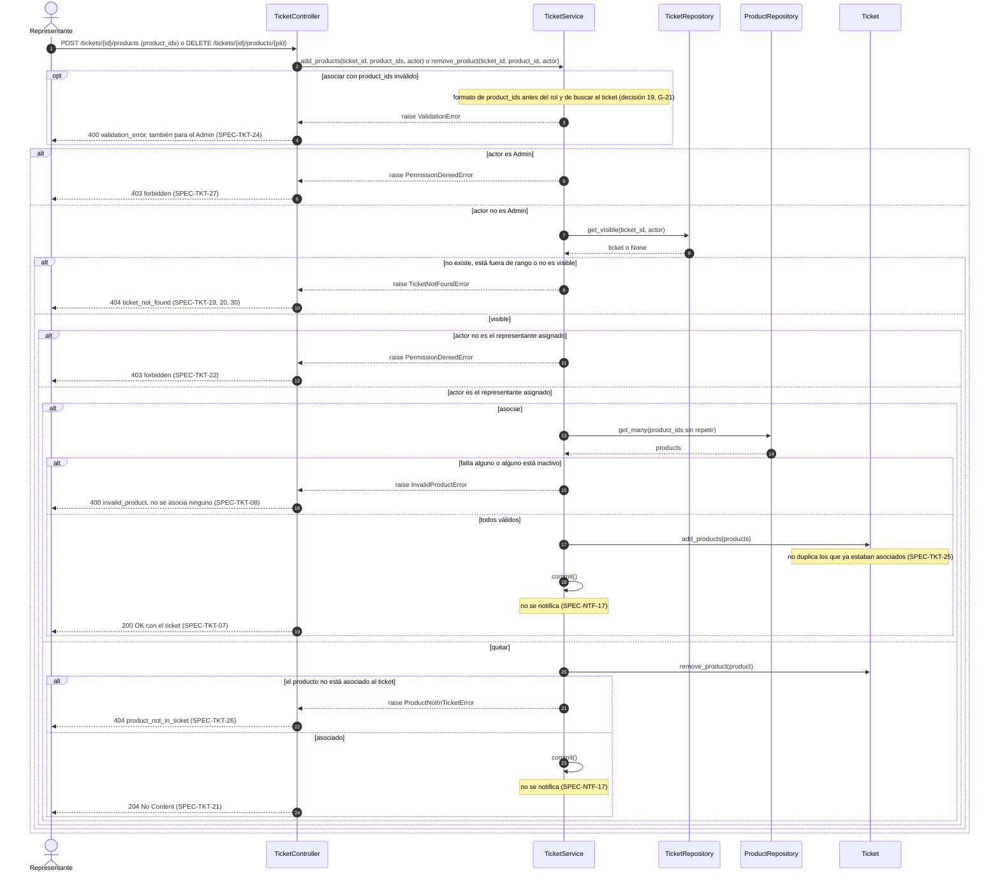

# Secuencias — 04 Ciclo de vida del ticket

Spec: [specs/04-tickets/spec.md](../../specs/04-tickets/spec.md)

Convención de transacción: el service hace `commit()` de la operación del ticket **antes** de notificar. Así, si falla una notificación, el cambio no se revierte (SPEC-NTF-04). El detalle del envío está en [06-notifications.md](06-notifications.md).

Convenciones del código actual:

- El `TicketController` solo lee el cuerpo JSON y delega con `actor=current_user`; todas las reglas, incluido el `403`, las decide el `TicketService`. Los errores de dominio se traducen en `controllers/errors.py`: `400` `validation_error`, `invalid_client` e `invalid_product`; `403` `forbidden`; `404` `ticket_not_found` y `product_not_in_ticket`; `409` `invalid_transition`.
- El service lee `clock()` una vez y pasa `now` al dominio. El dominio no lee el reloj, y toda transición pasa por `Ticket._enter`, que cambia `state_name` y agrega el `StateChange`.
- Los pasos `NS.notify` son de [06-notifications](../../specs/06-notifications/spec.md): `TicketService` recibe un `NotificationService` (`app/wiring.py`) y lo llama como última acción, después del `commit()`; el mensaje sale de `app/services/notification_messages.py`. Si la operación no termina con éxito (`4xx` o `500`), no se notifica (SPEC-NTF-15). El destinatario del cierre y de la reapertura es la contraparte del actor (`_notify_counterpart`).

## 1. Creación de ticket

Specs: SPEC-TKT-01, 02, 03, 04, 05, 06, 08, 15, 23, 24, 27, 31 · SPEC-NTF-05, 15

## 2. Cierre de ticket (patrón State)

Specs: SPEC-TKT-10, 13, 14, 16, 19, 20, 27, 30 · SPEC-NTF-07, 13, 15

## 3. Reapertura de ticket

Specs: SPEC-TKT-11, 12, 13, 14, 16, 19, 20, 27, 30 · SPEC-NTF-07, 10, 15

## 4. Acceso y privacidad

Specs: SPEC-TKT-17, 18, 19, 20, 27, 28, 29, 30

## 5. Asociar y quitar productos

Specs: SPEC-TKT-07, 08, 19, 20, 21, 22, 24, 25, 26, 27, 30 · SPEC-NTF-17

