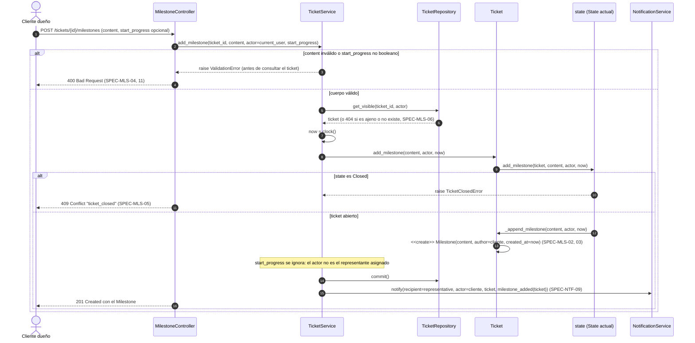
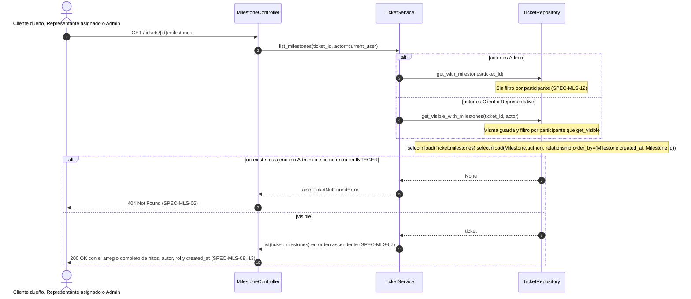
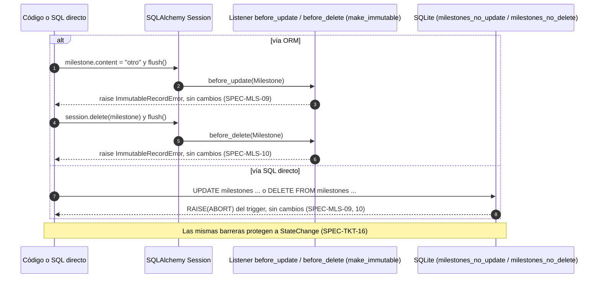

# Secuencias — 05 Hitos

Spec: [specs/05-milestones/spec.md](../../specs/05-milestones/spec.md)

## 1. Registro de hito por el representante (con transición opcional)

Specs: SPEC-MLS-01, 03, 04, 05, 06, 11 · SPEC-TKT-09, 14, 32 · SPEC-NTF-06, 08

Orden de las reglas (decisión 11): formato `400` → `Admin` `403` → ticket visible `404` → estado `Closed` `409`. El service lee `clock()` una vez y pasa `now` al dominio. Los pasos `NS.notify` son de [06-notifications](06-notifications.md): `TicketService` los ejecuta después del `commit()` y solo si este termina con éxito (SPEC-NTF-15).

```mermaid
sequenceDiagram
    autonumber
    actor Rep as Representante asignado
    participant MC as MilestoneController
    participant TS as TicketService
    participant TR as TicketRepository
    participant T as Ticket
    participant S as state (State actual)
    participant NS as NotificationService

    Rep->>MC: POST /tickets/{id}/milestones (content, start_progress)
    MC->>TS: add_milestone(ticket_id, content, actor=current_user, start_progress=body.get("start_progress", False))
    alt content vacío, solo espacios u otro tipo, o start_progress no booleano
        TS-->>MC: raise ValidationError (sin consultar el ticket)
        MC-->>Rep: 400 Bad Request (SPEC-MLS-04, 11)
    else actor es Admin
        TS-->>MC: raise PermissionDeniedError
        MC-->>Rep: 403 Forbidden (SPEC-TKT-32)
    else cuerpo válido
        TS->>TR: get_visible(ticket_id, actor)
        Note over TS,TR: Si no es el cliente dueño ni el representante asignado, o no existe → 404 (SPEC-MLS-06)
        TR-->>TS: ticket
        TS->>TS: now = clock() (una sola lectura)
        TS->>T: add_milestone(content, actor, now)
        T->>S: add_milestone(ticket, content, actor, now)
        alt state es Closed (ClosedState)
            S-->>TS: raise TicketClosedError
            TS-->>MC: TicketClosedError
            MC-->>Rep: 409 Conflict "ticket_closed" (SPEC-MLS-05)
        else ticket abierto
            S->>T: _append_milestone(content, actor, now)
            T->>T: <<create>> Milestone(content, author=actor, created_at=now) (SPEC-MLS-01, 03)
            opt start_progress y actor es el representante asignado
                TS->>T: request_progress(actor, now)
                T->>S: request_progress(ticket, actor, now)
                Note over S: NewState transiciona y devuelve True; State por defecto (InProgress) devuelve False sin error (dec. 5 y 6)
                S->>S: NewState.in_progress(ticket, actor, now)
                S->>T: _enter(InProgressState, actor, now) (SPEC-TKT-09)
                T->>T: <<create>> StateChange(actor, InProgress, now) (SPEC-TKT-14)
                S-->>TS: True (hubo cambio de estado) o False
            end
            TS->>TR: commit()
            Note over TS: changed = el retorno de request_progress (False si no se invocó)
            alt changed es True
                TS->>NS: notify(client, actor, ticket, milestone_and_state_changed(ticket)) (SPEC-NTF-08)
            else solo hito
                TS->>NS: notify(client, actor, ticket, milestone_added(ticket)) (SPEC-NTF-06)
            end
            TS-->>MC: milestone
            MC-->>Rep: 201 Created con el Milestone
        end
    end
```

## 2. Respuesta del cliente

Specs: SPEC-MLS-02, 03, 04, 05, 06, 11 · SPEC-NTF-09, 15

El cliente puede mandar `start_progress`, pero se ignora: `request_progress` solo se invoca si el autor es el representante asignado (dec. 5 y 6). El paso `NS.notify` es de [06-notifications](06-notifications.md) y solo se ejecuta después de un `commit()` exitoso (SPEC-NTF-15).



## 3. Listado cronológico de hitos

Specs: SPEC-MLS-06, 07, 08, 12, 13

Decisión 13: el `Admin` lee los hitos de cualquier ticket (usa `get_with_milestones`, sin filtro de participante); las comprobaciones son (0) sin sesión `401` y (1) ticket inexistente, fuera de rango o ajeno para un `Client` o `Representative` `404`. Se permite en cualquier estado. El listado no se pagina: devuelve siempre el arreglo completo e ignora `page` y `page_size` (SPEC-MLS-13).



## 4. Intento de modificar o borrar un hito

Specs: SPEC-MLS-09, 10

No existe ninguna ruta ni método de service que modifique o borre hitos. Este diagrama muestra las dos barreras que actúan si alguien lo intenta por código o con SQL directo.


