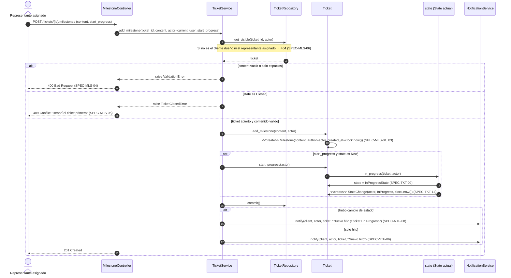
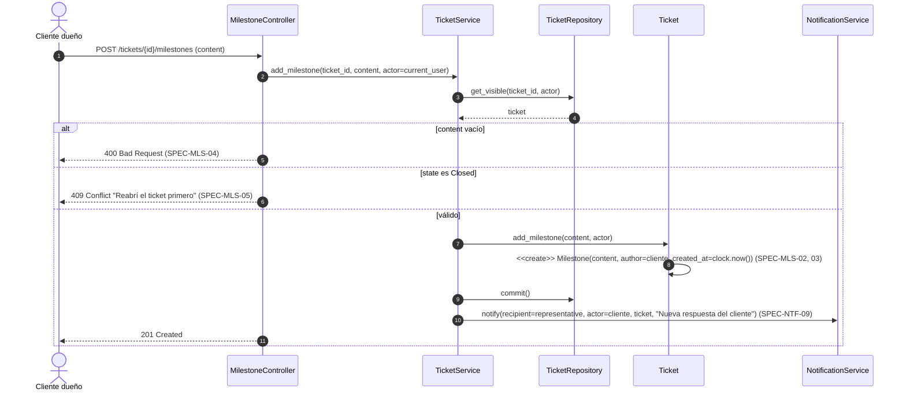
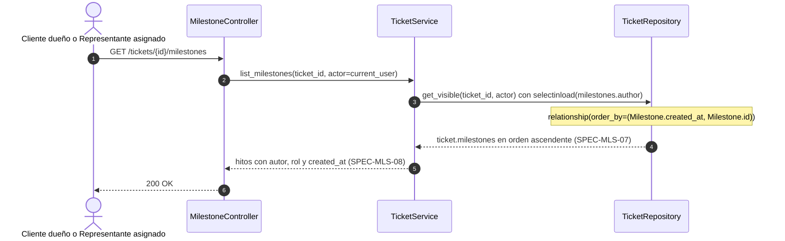
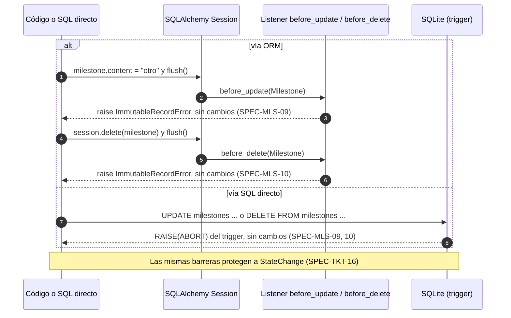

# Secuencias — 05 Hitos

Spec: [specs/05-milestones/spec.md](../../specs/05-milestones/spec.md)

## 1. Registro de hito por el representante (con transición opcional)

Specs: SPEC-MLS-01, 03, 04, 05, 06 · SPEC-TKT-09, 14 · SPEC-NTF-06, 08

## 2. Respuesta del cliente

Specs: SPEC-MLS-02, 03, 04, 05 · SPEC-NTF-09

## 3. Listado cronológico de hitos

Specs: SPEC-MLS-07, 08

## 4. Intento de modificar o borrar un hito

Specs: SPEC-MLS-09, 10

No existe ninguna ruta ni método de service que modifique o borre hitos. Este diagrama muestra las dos barreras que actúan si alguien lo intenta por código o con SQL directo.

