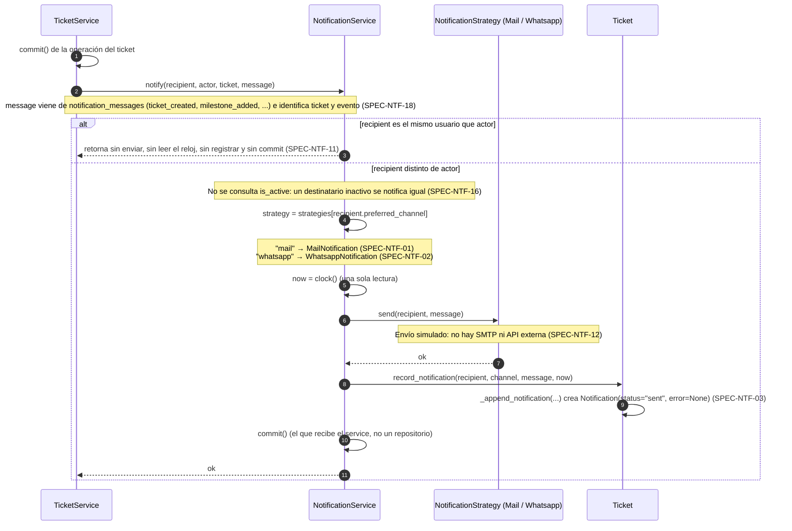
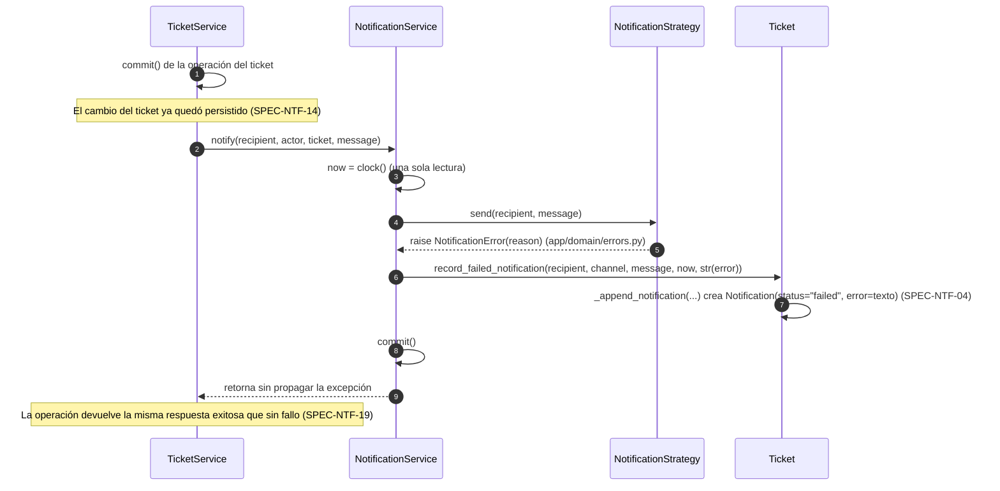

# Secuencias — 06 Notificaciones

Spec: [specs/06-notifications/spec.md](../../specs/06-notifications/spec.md)

`NotificationService(strategies, clock, commit).notify(recipient, actor, ticket, message)` es el único punto de entrada. `TicketService` lo llama como última acción de la operación, **después** de su propio `commit()`, mediante `_notify_counterpart` (cierre, reapertura e hitos) o directo al cliente (creación). Los mensajes salen de las funciones de `app/services/notification_messages.py`.

No hay `NotificationRepository`: la `Notification` se crea solo a través del ticket (`Ticket.record_notification` y `Ticket.record_failed_notification`, ambas por `_append_notification`) y la persiste el `commit()` que recibe el `NotificationService`.

SPEC-NTF-15: se notifica solo después de un `commit()` exitoso del ticket; una operación que termina en `4xx` o `500` nunca llega a `notify`.

## Matriz de eventos

| Evento | Quién actúa | Destinatario | Spec |
|--------|-------------|--------------|------|
| Ticket creado (`ticket_created`) | Representante | Cliente | SPEC-NTF-05 |
| Nuevo hito (`milestone_added`) | Representante | Cliente | SPEC-NTF-06 |
| Cambio de estado (`ticket_closed` / `ticket_reopened`) | Representante | Cliente | SPEC-NTF-07 |
| Hito y cambio de estado juntos (`milestone_and_state_changed`) | Representante | Cliente (una sola notificación) | SPEC-NTF-08 |
| Respuesta (hito, `milestone_added`) | Cliente | Representante | SPEC-NTF-09 |
| Reapertura (`ticket_reopened`) | Cliente | Representante | SPEC-NTF-10 |
| Cierre (`ticket_closed`) | Cliente | Representante | SPEC-NTF-13 |

## 1. Envío con patrón Strategy

Specs: SPEC-NTF-01, 02, 03, 11, 12, 16, 18

## 2. Falla en el envío

Specs: SPEC-NTF-04, 14, 19

