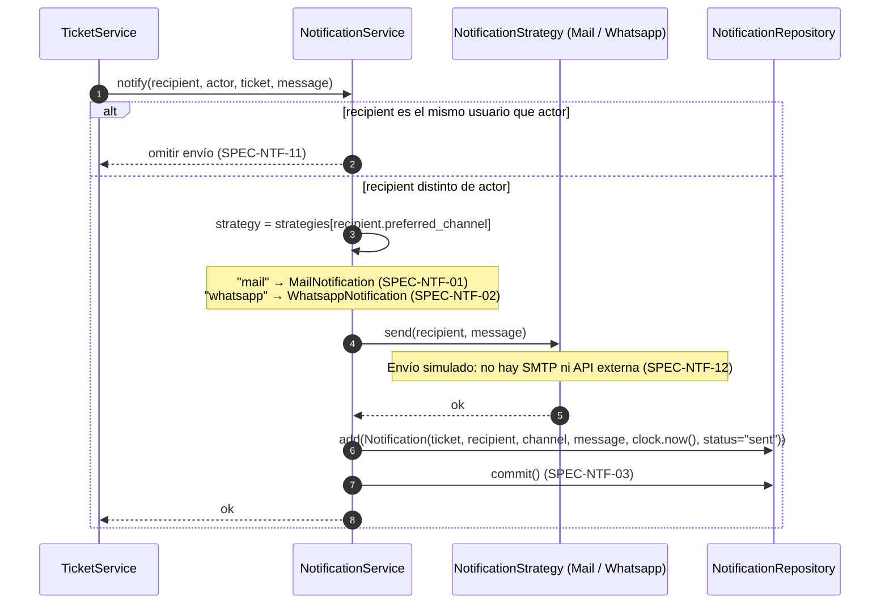
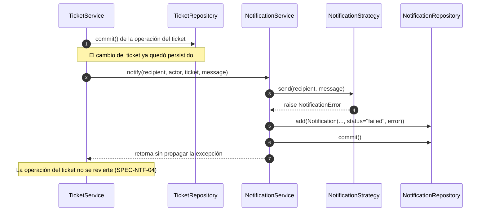

# Secuencias — 06 Notificaciones

Spec: [specs/06-notifications/spec.md](../../specs/06-notifications/spec.md)

`NotificationService.notify(recipient, actor, ticket, message)` es el único punto de entrada. Lo llaman los services de tickets e hitos **después** del `commit()` de la operación del ticket.

## Matriz de eventos

| Evento | Quién actúa | Destinatario | Spec |
|--------|-------------|--------------|------|
| Ticket creado | Representante | Cliente | SPEC-NTF-05 |
| Nuevo hito | Representante | Cliente | SPEC-NTF-06 |
| Cambio de estado | Representante | Cliente | SPEC-NTF-07 |
| Hito y cambio de estado juntos | Representante | Cliente (una sola notificación) | SPEC-NTF-08 |
| Respuesta (hito) | Cliente | Representante | SPEC-NTF-09 |
| Reapertura | Cliente | Representante | SPEC-NTF-10 |
| Cierre | Cliente | Representante | SPEC-NTF-13 |

## 1. Envío con patrón Strategy

Specs: SPEC-NTF-01, 02, 03, 11, 12

## 2. Falla en el envío

Specs: SPEC-NTF-04

