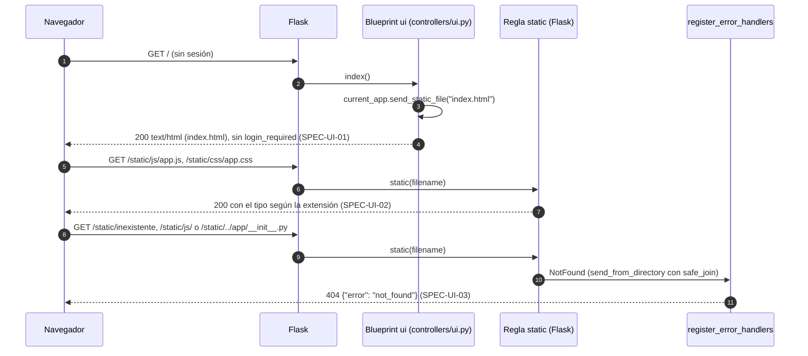
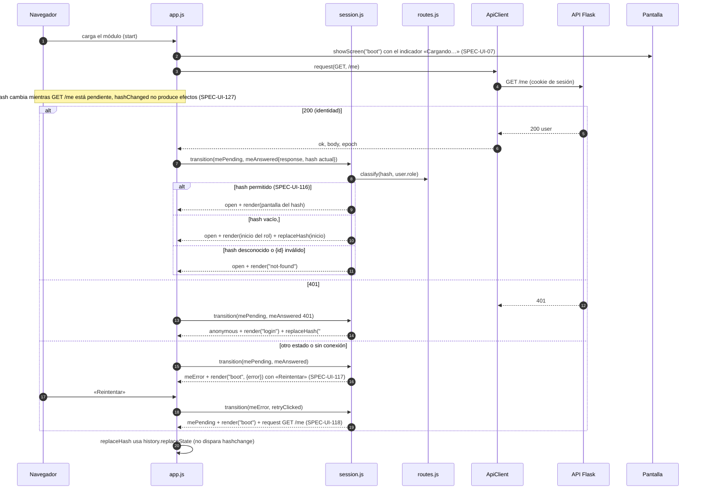
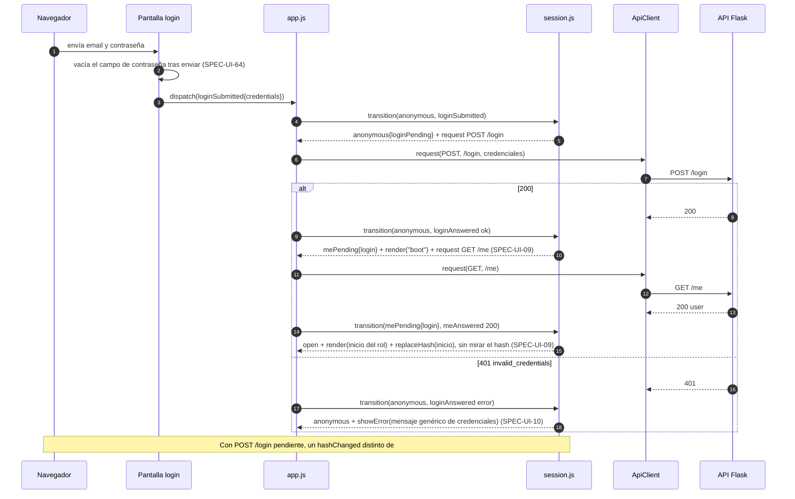
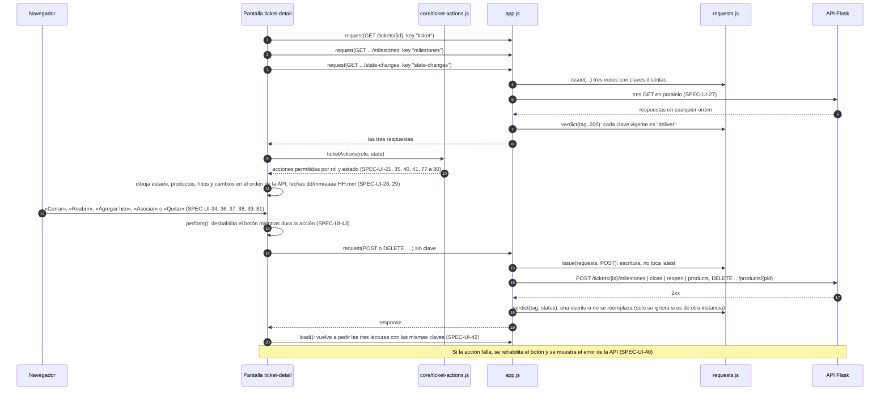
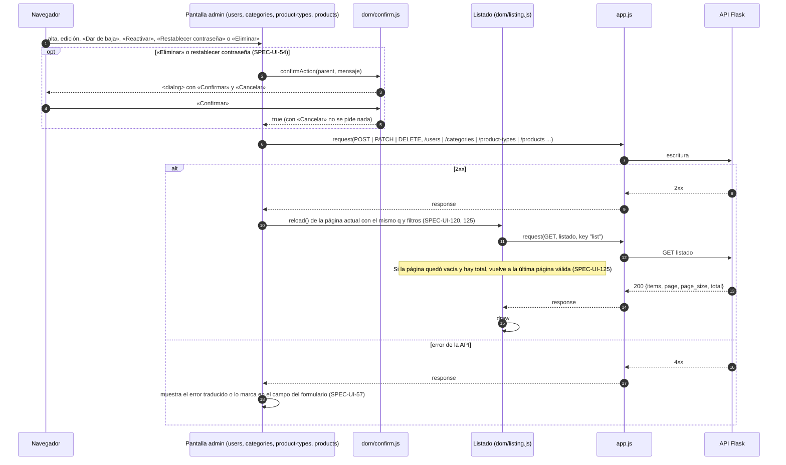
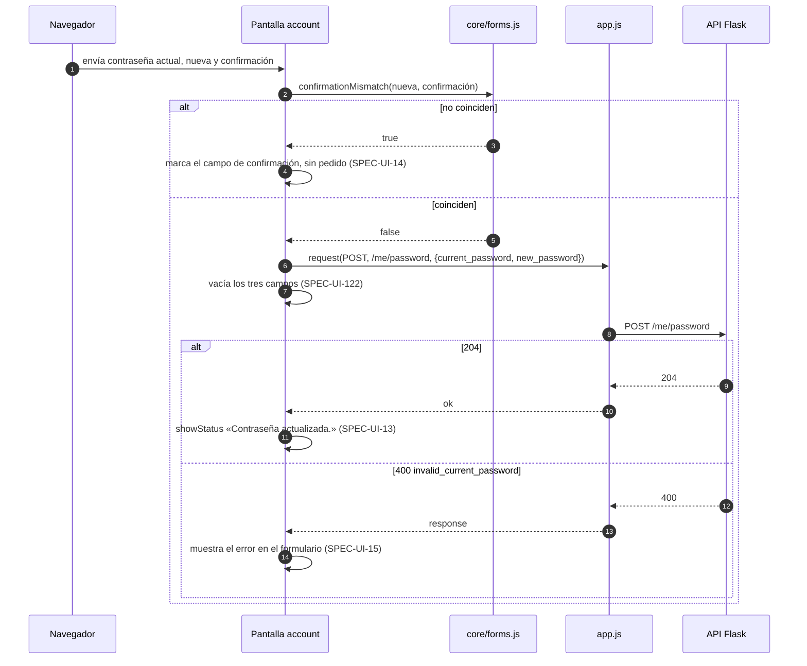

# Secuencias — 07 Interfaz web

Spec: [specs/07-ui/spec.md](../../specs/07-ui/spec.md)

La interfaz es un front plano (módulos ES sin build) que Flask sirve desde `app/static/`. No tiene dominio, services ni repositorios: todo dato y toda regla vienen de la API de 00 a 05. Las piezas que aparecen en los diagramas:

- `app.js` es el único punto que toca `window`, `document`, `location`, `history` y `fetch`. Guarda el estado de la sesión (`state`) y el de pedidos (`requests`), y ejecuta los efectos que devuelve el reductor.
- `session.js` (`core/session.js`) es el reductor puro `transition(state, event) → { state, effects }`; los estados son `mePending`, `meError`, `anonymous`, `open` y `closing`, y cada uno lleva su `epoch`.
- `routes.js` (`core/routes.js`) clasifica el hash según el rol (`screen`, `home`, `forbidden`, `not_found`).
- `requests.js` (`core/requests.js`) es el token de pantalla y de pedido: `openScreen`, `issue(method, key)` y `verdict(tag, status)`.
- `ApiClient` (`net/api-client.js`, `createApiClient(fetchFn, {epoch, canSend})`) manda el pedido con `credentials: "same-origin"` y sin `Authorization`, y devuelve `{ ok, status, body, networkError, epoch }`. Con `canSend()` falso (`closing`) no envía nada.
- `Pantalla` es el módulo de `screens/` que corresponde a la ruta (`mount(context)`); `Listado` es `dom/listing.js` (`createListing`).

Orden en `app.js` al llegar la respuesta de un pedido de una pantalla: (1) `dispatch(apiAnswered)` con la época con la que salió; la máquina ignora una época vieja (SPEC-UI-130) y convierte un `401` de la época vigente en sesión vencida (SPEC-UI-12); (2) si la época es la vigente y el estado no es `401`, consulta `verdict`; (3) solo entonces entrega la respuesta a la pantalla. Una respuesta ignorada nunca llega a la pantalla: ni datos, ni mensaje de error, ni navegación.

## 0. Servido de la interfaz

Specs: SPEC-UI-01, 02, 03



## 1. Carga inicial

Specs: SPEC-UI-04, 07, 08, 116, 117, 118, 127, 128



## 2. Inicio de sesión

Specs: SPEC-UI-09, 10, 64, 126



## 3. Navegación con sesión abierta

Specs: SPEC-UI-16, 17, 18, 19, 20, 30, 31, 32, 33, 97, 124, 132, 136

```mermaid
sequenceDiagram
    autonumber
    participant B as Navegador
    participant A as app.js
    participant S as session.js
    participant R as routes.js
    participant Q as requests.js
    participant SH as dom/shell.js
    participant P as Pantalla
    participant API as API Flask

    B->>A: hashchange
    A->>S: transition(open, hashChanged{hash})
    S->>R: classify(hash, role)
    alt permitido
        S-->>A: render(pantalla, params)
    else vacío, #/login o no permitido (SPEC-UI-19, 124)
        S-->>A: render(inicio del rol) + replaceHash(inicio) (SPEC-UI-132)
    else desconocido o {id} inválido (SPEC-UI-20, 97)
        S-->>A: render("not-found") sin pedidos
    end
    A->>Q: openScreen(requests): instancia de pantalla nueva
    Note over A,Q: Una instancia por pantalla mostrada, también al volver a la misma ruta; no al recargar dentro de la pantalla (SPEC-UI-136)
    A->>SH: renderShell(usuario): navegación por rol (SPEC-UI-16, 17, 18)
    A->>P: mount(context)
    Note over P,API: Ejemplo: #/tickets/new (SPEC-UI-30, 31, 32)
    P->>A: request(GET, /clients?q=, key "clients")
    A->>API: GET /clients?q=
    P->>A: request(POST, /tickets, body)
    A->>API: POST /tickets (instancia 1)
    B->>A: el usuario sale a #/account y vuelve a #/tickets/new (instancias 2, 3 y 4)
    API-->>A: 201 (o falla de conexión) de la instancia 1
    A->>Q: verdict(tag, status): tag.screen != requests.screen
    Q-->>A: "ignore"
    A->>A: la pantalla no recibe la respuesta: no navega, sin mensaje (SPEC-UI-136)
    Note over A,API: Con la instancia vigente, 201 llega a la pantalla y navigate("#/tickets/{id}") (SPEC-UI-33)
```

## 4. Cierre de sesión

Specs: SPEC-UI-11, 129, 130, 131, 133, 134

```mermaid
sequenceDiagram
    autonumber
    participant B as Navegador
    participant SH as dom/shell.js
    participant A as app.js
    participant S as session.js
    participant I as dom/inert.js
    participant C as ApiClient
    participant API as API Flask

    B->>SH: «Cerrar sesión»
    SH->>A: dispatch(logoutClicked)
    A->>S: transition(open, logoutClicked)
    S-->>A: closing{route}, epoch + 1, identidad descartada (SPEC-UI-11) + request POST /logout + setInert(true)
    A->>I: setInert([header, root], true)
    Note over I: Desactiva button, input, select y textarea, marca los enlaces con aria-disabled y cancela click, submit, change e input en captura (SPEC-UI-133, 134)
    A->>C: logoutClient.request(POST, /logout)
    C->>API: POST /logout (retrasado)
    B->>I: clic, submit o hash distinto
    I-->>B: cancelado; hashChanged en closing no produce efectos (SPEC-UI-131, 133)
    Note over C: El cliente de pantallas tiene canSend() falso en closing: no envía nada (SPEC-UI-133)
    API-->>C: respuesta de un pedido anterior (época vieja)
    A->>S: transition(closing, apiAnswered epoch vieja)
    S-->>A: ignorada: sin datos ni aviso (SPEC-UI-130)
    API-->>C: 204, cualquier estado o sin conexión de POST /logout
    A->>S: transition(closing, logoutSettled)
    S-->>A: anonymous + render("login") + replaceHash("#/login") + setInert(false) (SPEC-UI-129, 128)
```

## 5. Sesión vencida

Specs: SPEC-UI-12, 128, 130

```mermaid
sequenceDiagram
    autonumber
    participant P as Pantalla
    participant A as app.js
    participant C as ApiClient
    participant API as API Flask
    participant S as session.js
    participant Q as requests.js

    P->>A: request(GET, /tickets, ..., key)
    A->>C: request(GET, /tickets)
    C->>API: GET /tickets
    API-->>C: 401 (con la época vigente)
    C-->>A: { status: 401, epoch }
    A->>S: dispatch(apiAnswered{epoch, response})
    S-->>A: anonymous{notice: true}, epoch + 1 + render("login", {notice: true}) + replaceHash("#/login") (SPEC-UI-12, 128)
    Note over A,Q: Un 401 de la época vigente avisa «Tu sesión venció. Inicia sesión nuevamente.» aunque su pedido haya quedado reemplazado: verdict devuelve "deliver" para 401, pero la máquina ya decidió
    A->>A: la respuesta no se entrega a la pantalla (current es falso para 401)
    Note over S: Un 401 de una época vieja se ignora sin aviso (SPEC-UI-130); POST /login, POST /logout y el GET /me de carga no pasan por esta regla
```

## 6. Listado paginable con filtros

Specs: SPEC-UI-22, 23, 24, 25, 26, 41, 101, 102, 103, 104, 105, 106, 107, 108, 115, 119, 135

```mermaid
sequenceDiagram
    autonumber
    participant B as Navegador
    participant P as Pantalla tickets-list
    participant L as Listado (dom/listing.js)
    participant Qy as core/query.js
    participant A as app.js
    participant Q as requests.js
    participant API as API Flask

    P->>L: createListing({path "/tickets", columns, row, filters})
    L->>Qy: reloadQuery(path, state): page, page_size=20 (SPEC-UI-26, 101)
    L->>A: request(GET, /tickets?page=1&page_size=20, key "list")
    A->>Q: issue(requests, GET, "list"): latest.list = 1
    A->>API: GET /tickets?... (consulta 1)
    B->>L: cambia el filtro de estado (SPEC-UI-23, 24, 25) o envía la búsqueda q
    L->>Qy: applyFilter(state, cambios): vuelve a la página 1
    L->>A: request(GET, /tickets?state=Closed&..., key "list")
    A->>Q: issue(...): latest.list = 2
    A->>API: GET /tickets?state=Closed&... (consulta 2)
    API-->>A: respuesta de la consulta 2
    A->>Q: verdict(tag 2, 200): "deliver"
    A-->>L: response
    L->>L: draw: tabla, paginador «Anterior» / «Siguiente», página y total (SPEC-UI-102 a 106)
    API-->>A: respuesta de la consulta 1 (llega después)
    A->>Q: verdict(tag 1, 200): latest.list != 1
    Q-->>A: "ignore"
    A->>A: sin datos, sin error y sin quitar el indicador de carga vigente (SPEC-UI-135)
    Note over L: Lista vacía: «No hay resultados» (SPEC-UI-115); un error de la API se traduce con messages.js (SPEC-UI-119)
    Note over A,Q: Una respuesta 401 de la consulta 1 no se ignora: la máquina la trata como sesión vencida (SPEC-UI-12, 135)
```

## 7. Acción sobre un ticket y recarga

Specs: SPEC-UI-21, 27, 28, 29, 34, 35, 36, 37, 38, 39, 40, 41, 42, 43, 77, 78, 79, 80, 81, 135



## 8. Acción de administración y recarga

Specs: SPEC-UI-44, 45, 46, 47, 48, 49, 50, 51, 52, 53, 54, 82, 83, 84, 85, 86, 87, 88, 89, 90, 91, 92, 93, 94, 95, 100, 109, 110, 111, 120, 125



## 9. Cambio de contraseña

Specs: SPEC-UI-13, 14, 15, 122



## Specs transversales

Specs: SPEC-UI-05, 06, 55, 56, 57, 58, 59, 60, 61, 62, 63, 65, 66, 67, 68, 69, 70, 71, 72, 73, 74, 75, 76, 96, 98, 99, 112, 113, 114, 121, 123

No son secuencias: son reglas de todo el front (sin orígenes externos ni almacenamiento, texto como texto, sin estilos ni scripts en línea, accesibilidad y diseño adaptable, mensajes y etiquetas, `core/` puro con `fetch` inyectado, estructura de pruebas y trazabilidad). Se comprueban con el escaneo estático, `node --test`, Playwright y `tests/ui/test_traceability.py`.
