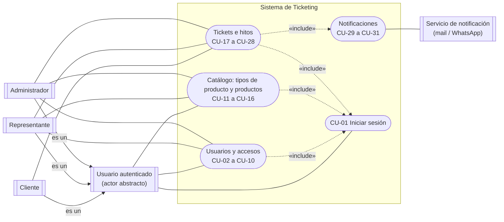
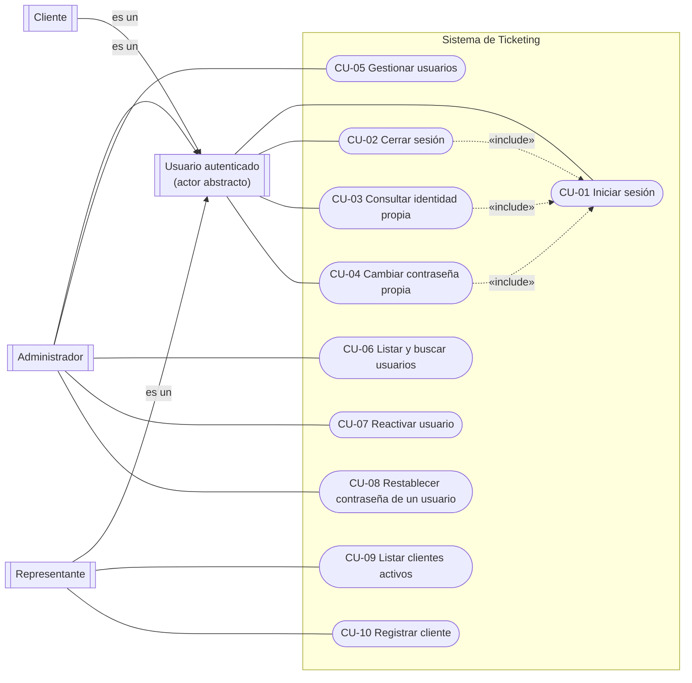
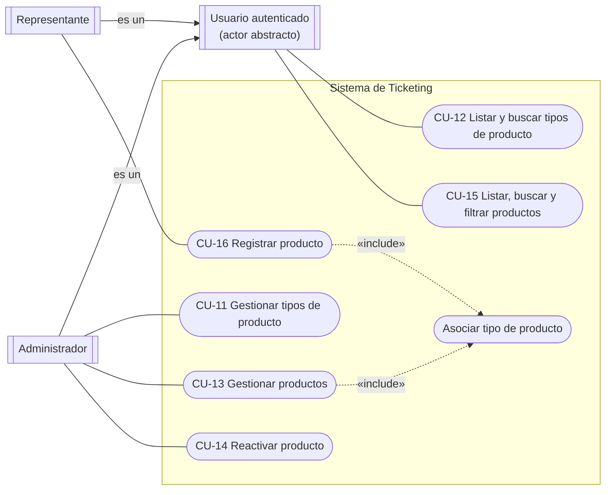
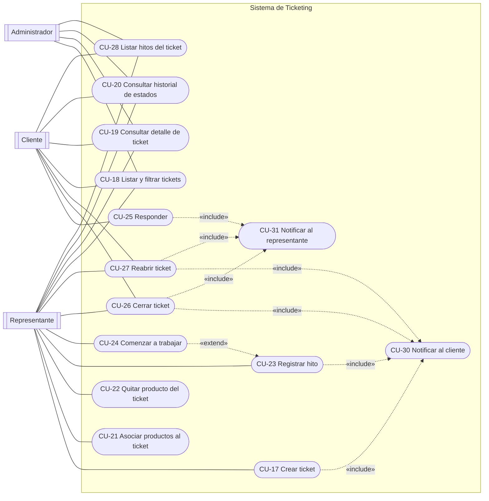
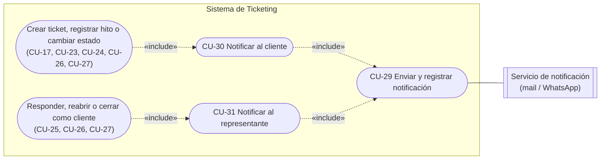

# Modelo de casos de uso

Fuente: [docs/REQUERIMIENTOS.md](../docs/REQUERIMIENTOS.md) (RF 1.1 a 1.6 y los RNF que condicionan cada caso) y las specs de [specs/](../specs/). Complementa a [classes.md](classes.md) (estructura) y a [sequences/](sequences/) (comportamiento): acá se ve **quién hace qué** con el sistema.

## Convenciones

Mermaid no tiene un diagrama de casos de uso nativo, así que se usa `flowchart LR`:

- Los **actores** son nodos con borde doble (`[["..."]]`) fuera del recuadro. El actor externo «Servicio de notificación» es un actor secundario: el sistema lo invoca, no al revés.
- El **límite del sistema** es el `subgraph` «Sistema de Ticketing». Los **casos de uso** son nodos ovalados (`(["..."])`) dentro de él.
- Línea continua sin flecha: asociación actor ↔ caso de uso.
- Flecha continua con la etiqueta «es un»: generalización entre actores. **Usuario autenticado** es un actor abstracto del que heredan Cliente, Representante y Administrador (los tres inician sesión, consultan su identidad y cambian su contraseña).
- Flecha punteada «include»: el caso de origen incluye siempre al de destino. Flecha punteada «extend»: el caso de origen amplía opcionalmente al de destino.
- **Autenticación:** todo caso de uso, salvo CU-01 «Iniciar sesión», incluye CU-01 (RNF 2: todas las rutas salvo login, salud, documentación e interfaz exigen sesión). Se dibuja una sola vez, en la vista general; en los diagramas de paquete se omite para no duplicar una flecha por cada caso.
- Los casos se numeran `CU-NN` de corrido y se agrupan por las secciones de los RF.
- **Privacidad (RNF 4):** un cliente solo ve sus tickets y un representante solo los que tiene asignados; sobre un ticket ajeno el sistema responde `404`, como si no existiera. **Administrador:** solo lee tickets, hitos e historial; no los crea ni los modifica (`403`).
- RF 1.2.3 está eliminado (el tipo de producto es el rubro) y no se modela. RF 1.7 (interfaz web) es el **canal de entrega** de estos mismos casos, no un caso de uso aparte: la interfaz solo los expone a las tres personas usuarias.

## 1. Vista general

Cada paquete agrupa los casos de uso de una sección de los RF. Los detalles están en los diagramas siguientes.

## 2. Usuarios y accesos (RF 1.1)

| ID | Caso de uso | Actor(es) | RF de origen | Specs |
|----|-------------|-----------|--------------|-------|
| CU-01 | Iniciar sesión con email y contraseña (el error es genérico y no revela si el email existe) | Usuario autenticado (Cliente, Representante, Administrador) | RF 1.7.5 · RNF 2 | 01-users, 00-platform |
| CU-02 | Cerrar sesión | Usuario autenticado | RF 1.7.5 | 01-users |
| CU-03 | Consultar la identidad propia (nombre, email y rol) | Usuario autenticado | RF 1.1.8 | 01-users |
| CU-04 | Cambiar la contraseña propia | Usuario autenticado | RF 1.1.7 · RF 1.7.5 | 01-users |
| CU-05 | Gestionar usuarios de cualquier rol, incluidos representantes y administradores: alta, modificación y baja lógica (el usuario inactivo no inicia sesión y conserva su historial) | Administrador | RF 1.1.1 · RF 1.1.3 · RF 1.1.5 · RNF 3 | 01-users |
| CU-06 | Listar y buscar usuarios por nombre o email, con filtro por estado y distinguiendo el rol (administradores, representantes y clientes) | Administrador | RF 1.1.2 · RF 1.1.4 · RNF 10 | 01-users |
| CU-07 | Reactivar un usuario inactivo | Administrador | RF 1.1.6 | 01-users |
| CU-08 | Restablecer la contraseña de cualquier usuario sin conocer la anterior | Administrador | RF 1.1.7 | 01-users |
| CU-09 | Listar los clientes activos (solo identificador y nombre) para elegir el cliente de un ticket | Representante | RF 1.1.9 | 01-users |
| CU-10 | Registrar un cliente (alta de usuario con rol Cliente únicamente) mientras lo atiende por teléfono | Representante | RF 1.1.10 | 01-users (SPEC-USR-51 a 54) |

CU-05 comparte la regla de unicidad del email (RNF 3). El representante no puede modificar, dar de baja, reactivar ni restablecer la contraseña de nadie: CU-05, CU-07 y CU-08 son solo del Administrador.

## 3. Catálogo: tipos de producto y productos (RF 1.2 y 1.3)

El tipo de producto es el rubro; no hay categorías. Los listados y las búsquedas están abiertos a cualquier usuario autenticado.

| ID | Caso de uso | Actor(es) | RF de origen | Specs |
|----|-------------|-----------|--------------|-------|
| CU-11 | Gestionar tipos de producto: alta, modificación y baja | Administrador | RF 1.2.1 · RF 1.1.5 | 02-product-types (SPEC-PTY-34) |
| CU-12 | Listar tipos de producto y buscarlos por nombre | Usuario autenticado | RF 1.2.2 · RF 1.2.4 | 02-product-types |
| CU-13 | Gestionar productos: alta, modificación y baja lógica (el producto inactivo se conserva en los tickets existentes pero no se asocia a tickets nuevos); incluye asociar el producto a un tipo | Administrador | RF 1.3.1 · RF 1.3.2 | 03-products |
| CU-14 | Reactivar un producto inactivo | Administrador | RF 1.3.4 | 03-products (SPEC-PRD-25) |
| CU-15 | Listar productos, buscarlos por nombre y filtrarlos por estado y por tipo de producto; los disponibles para un ticket son solo los activos | Usuario autenticado | RF 1.3.3 · RF 1.3.5 | 03-products (SPEC-PRD-10, 26, 27, 31, 32) |
| CU-16 | Registrar un producto (nombre y tipo de producto) en el momento de la consulta; no puede modificarlo, darlo de baja ni reactivarlo | Representante | RF 1.3.6 · RF 1.3.2 | 03-products (SPEC-PRD-35 a 37) |

«Asociar tipo de producto» no tiene ID propio: es el paso común de CU-13 y CU-16 que exige un tipo válido (RF 1.3.2).

## 4. Tickets e hitos (RF 1.4 y 1.5)

| ID | Caso de uso | Actor(es) | RF de origen | Specs |
|----|-------------|-----------|--------------|-------|
| CU-17 | Crear un ticket para un cliente, con primer mensaje (hito inicial) y productos opcionales; queda en Nuevo y asignado al representante que lo crea | Representante | RF 1.4.1 · RF 1.4.2 · RF 1.4.3 · RF 1.4.6 · RF 1.5.1 | 04-tickets (SPEC-TKT-01 a 06, 31) |
| CU-18 | Listar tickets con filtros por estado, cliente, representante (solo Administrador) y texto, y orden por fecha de creación; el Cliente ve los propios, el Representante los asignados y el Administrador todos | Cliente, Representante, Administrador | RF 1.4.8 · RF 1.4.9 · RNF 4 · RNF 10 | 04-tickets (SPEC-TKT-17, 18, 33, 38 a 48) |
| CU-19 | Consultar el detalle de un ticket (estado, cliente, representante y productos); sobre un ticket ajeno responde `404` | Cliente, Representante, Administrador | RF 1.4.2 · RF 1.4.3 · RF 1.4.6 · RF 1.4.8 · RNF 4 | 04-tickets (SPEC-TKT-19, 20, 28, 34) |
| CU-20 | Consultar el historial de cambios de estado (usuario, estado y momento UTC) | Cliente (dueño), Representante (asignado), Administrador | RF 1.4.10 · RNF 6 | 04-tickets (SPEC-TKT-35 a 37, 47) |
| CU-21 | Asociar productos activos a un ticket existente (la asociación repetida no se duplica) | Representante (asignado) | RF 1.4.6 | 04-tickets (SPEC-TKT-07, 08, 24, 25) |
| CU-22 | Quitar un producto asociado a un ticket | Representante (asignado) | RF 1.4.7 | 04-tickets (SPEC-TKT-21, 26) |
| CU-23 | Registrar un hito de texto en un ticket no cerrado, con autor y fecha UTC; los hitos son inmutables | Representante (asignado) | RF 1.5.1 · RNF 5 | 05-milestones (SPEC-MLS-01, 03 a 05, 09 a 11) |
| CU-24 | Comenzar a trabajar un ticket Nuevo: publica un hito de contenido fijo con `start_progress` y lo pasa a En Progreso; es el botón del encabezado del detalle y amplía a CU-23 | Representante (asignado) | RF 1.4.4 · RF 1.5.1 · RF 1.7.2 | 04-tickets (SPEC-TKT-09, 14), 05-milestones |
| CU-25 | Responder en un ticket propio no cerrado: agrega un hito de autoría del cliente | Cliente (dueño) | RF 1.5.1 · RF 1.6.3 · RNF 4 | 05-milestones (SPEC-MLS-02, 05, 06) |
| CU-26 | Cerrar un ticket Nuevo o En Progreso, registrando quién y cuándo | Cliente (dueño), Representante (asignado) | RF 1.4.4 · RNF 6 | 04-tickets (SPEC-TKT-10, 13, 14) |
| CU-27 | Reabrir un ticket cerrado: vuelve a En Progreso con el mismo representante que lo gestionó | Cliente (dueño), Representante (asignado) | RF 1.4.5 · RNF 6 | 04-tickets (SPEC-TKT-11, 12) |
| CU-28 | Listar los hitos del ticket en orden cronológico ascendente, formando el hilo de comunicación | Cliente (dueño), Representante (asignado), Administrador (solo lectura) | RF 1.5.2 · RF 1.5.3 · RNF 4 | 05-milestones (SPEC-MLS-07, 08, 12, 13) |

Notas:

- CU-24 «extend» CU-23: es un hito de CU-23 con la condición adicional de que el ticket esté en Nuevo. El formulario de hito no tiene casilla: el botón es el único camino para pasar a En Progreso.
- CU-26 y CU-27 notifican a la **contraparte** del actor: al cliente si actúa el representante (CU-30) y al representante si actúa el cliente (CU-31). El diagrama muestra ambas inclusiones porque cada ejecución usa una de las dos.
- El Administrador no participa de CU-17, CU-21 a CU-27: es de solo lectura y esas operaciones devuelven `403` (SPEC-TKT-32).

## 5. Notificaciones (RF 1.6)

| ID | Caso de uso | Actor(es) | RF de origen | Specs |
|----|-------------|-----------|--------------|-------|
| CU-29 | Enviar la notificación por el canal preferido del destinatario (mail o WhatsApp), registrarla en el ticket con su estado (`sent` o `failed`) y no revertir la operación si el envío falla | Servicio de notificación (secundario) | RF 1.6.1 | 06-notifications (SPEC-NTF-01 a 04, 12, 14, 15, 18, 19) |
| CU-30 | Notificar al cliente cuando el representante crea el ticket, registra un hito o cambia el estado (un hito que cambia el estado genera una sola notificación) | Servicio de notificación (secundario) | RF 1.6.1 · RF 1.6.2 | 06-notifications (SPEC-NTF-05 a 08) |
| CU-31 | Notificar al representante asignado cuando el cliente responde, reabre o cierra el ticket | Servicio de notificación (secundario) | RF 1.6.3 | 06-notifications (SPEC-NTF-09, 10, 13) |

Los casos de este paquete no los inicia una persona: los dispara el sistema como efecto de los casos de la sección 4. Si el destinatario es quien realizó la acción no se envía nada (SPEC-NTF-11), y una operación fallida (4xx o 5xx) no notifica (SPEC-NTF-15). El envío es simulado (SPEC-NTF-12): el actor secundario representa a los servicios de mail y WhatsApp.

## Cobertura de requerimientos

| RF | Casos de uso |
|----|--------------|
| 1.1.1 a 1.1.4 | CU-05 (1.1.1, 1.1.3), CU-06 (1.1.2, 1.1.4) |
| 1.1.5 | CU-05 y CU-11 (gestión del Administrador); solo lectura en CU-18, CU-19, CU-20 y CU-28 |
| 1.1.6 a 1.1.10 | CU-07 (1.1.6), CU-04 y CU-08 (1.1.7), CU-03 (1.1.8), CU-09 (1.1.9), CU-10 (1.1.10) |
| 1.2.1, 1.2.2, 1.2.4 | CU-11 (1.2.1), CU-12 (1.2.2, 1.2.4) |
| 1.3.1 a 1.3.6 | CU-13 (1.3.1, 1.3.2), CU-15 (1.3.3, 1.3.5), CU-14 (1.3.4), CU-16 (1.3.6) |
| 1.4.1 a 1.4.3 | CU-17 (y CU-19 para leerlos) |
| 1.4.4 y 1.4.5 | CU-24 y CU-26 (1.4.4), CU-27 (1.4.5) |
| 1.4.6 y 1.4.7 | CU-17 y CU-21 (1.4.6), CU-22 (1.4.7) |
| 1.4.8 a 1.4.10 | CU-18 y CU-19 (1.4.8), CU-18 (1.4.9), CU-20 (1.4.10) |
| 1.5.1 a 1.5.3 | CU-23 y CU-25 (1.5.1), CU-28 (1.5.2, 1.5.3) |
| 1.6.1 a 1.6.3 | CU-29 (1.6.1), CU-30 (1.6.2), CU-31 (1.6.3) |
| 1.7 | Canal de entrega (ver Convenciones); 1.7.5 se modela como CU-01, CU-02 y CU-04 |

Todos los RF de 1.1 a 1.6 quedan cubiertos; RF 1.2.3 no se modela por estar eliminado.

## Descripciones

### CU-17 Crear ticket

- **Actor:** Representante.
- **Precondición:** el representante tiene sesión; el cliente existe, tiene rol Cliente y está activo; los productos, si hay, existen y están activos.
- **Flujo principal:** 1) el representante elige el cliente (CU-09, o lo registra con CU-10), escribe el primer mensaje y opcionalmente elige productos; 2) el sistema valida los datos; 3) crea el ticket en estado Nuevo, asignado al representante, con el primer mensaje como hito inicial y con los productos asociados; 4) confirma la operación y notifica al cliente (CU-30, una sola notificación).
- **Alternativos y excepciones:** mensaje vacío, solo espacios o no textual: `400`. Cliente inexistente, sin rol Cliente o inactivo: rechazo. Algún producto inexistente o inactivo: se rechaza todo. Un usuario sin rol Representante, incluido el Administrador: `403`. Si el envío de la notificación falla, el ticket queda creado igual.
- **Postcondición:** existe un ticket Nuevo con un hito, el representante asignado y el cliente asociado.

### CU-23 Registrar hito

- **Actor:** Representante asignado.
- **Precondición:** el ticket existe, está asignado al representante y no está Cerrado.
- **Flujo principal:** 1) el representante escribe el contenido; 2) el sistema lo valida; 3) agrega el hito al ticket con el representante como autor y la fecha UTC del reloj; 4) notifica al cliente (CU-30).
- **Alternativos y excepciones:** contenido vacío, solo espacios o no textual: `400`. Ticket Cerrado: `409`, primero hay que reabrirlo. Ticket de otro representante o inexistente: `404`. Administrador: `403`.
- **Postcondición:** el hito queda registrado y es inmutable: ninguna ruta, método o consulta lo modifica o elimina (RNF 5).

### CU-24 Comenzar a trabajar

- **Actor:** Representante asignado.
- **Precondición:** el ticket está en Nuevo y asignado al representante.
- **Flujo principal:** 1) el representante pulsa «Comenzar a trabajar» en el encabezado del detalle; 2) el sistema registra un hito de contenido fijo con `start_progress` (extiende CU-23); 3) el ticket pasa a En Progreso y queda un cambio de estado con usuario y fecha UTC; 4) el cliente recibe **una sola** notificación que informa el hito y el nuevo estado.
- **Alternativos y excepciones:** el ticket no está en Nuevo: el botón no se ofrece y, si la petición se envía igual, la transición inválida se rechaza (`409`) sin modificar el ticket. Ticket ajeno: `404`.
- **Postcondición:** ticket En Progreso con un hito más y un registro de auditoría.

### CU-25 Responder

- **Actor:** Cliente dueño del ticket.
- **Precondición:** el ticket es del cliente y no está Cerrado.
- **Flujo principal:** 1) el cliente escribe su respuesta; 2) el sistema la valida; 3) la agrega como hito con el cliente de autor; 4) notifica al representante asignado (CU-31).
- **Alternativos y excepciones:** mensaje inválido: `400`. Ticket Cerrado: `409` (el cliente debe reabrirlo con CU-27). Ticket de otro cliente: `404`, como si no existiera (RNF 4).
- **Postcondición:** el hilo del ticket incluye la respuesta, sin cambio de estado.

### CU-26 Cerrar ticket

- **Actor:** Cliente dueño o Representante asignado.
- **Precondición:** el ticket está en Nuevo o En Progreso y el actor tiene acceso a él.
- **Flujo principal:** 1) el actor solicita el cierre; 2) el sistema lo pasa a Cerrado y registra quién y cuándo (RNF 6); 3) notifica a la contraparte: al cliente si cierra el representante (CU-30), al representante si cierra el cliente (CU-31).
- **Alternativos y excepciones:** el ticket ya está Cerrado: `409` `invalid_transition`, sin cambios. Ticket ajeno: `404`. Administrador: `403`.
- **Postcondición:** ticket Cerrado, que ya no admite hitos (solo reabrir).

### CU-27 Reabrir ticket

- **Actor:** Cliente dueño o Representante asignado.
- **Precondición:** el ticket está Cerrado y el actor tiene acceso a él.
- **Flujo principal:** 1) el actor solicita la reapertura; 2) el sistema reasigna el ticket al **mismo representante** que lo gestionó antes del cierre; 3) el ticket vuelve directamente a **En Progreso** y se registra el cambio de estado con usuario y fecha UTC; 4) se notifica a la contraparte (CU-30 o CU-31).
- **Alternativos y excepciones:** el ticket no está Cerrado: `409` `invalid_transition`. Ticket ajeno: `404`. Administrador: `403`. Si el representante original está inactivo, la reapertura igual lo reasigna a él (limitación conocida, ver [MEMORY.md](../MEMORY.md)).
- **Postcondición:** ticket En Progreso con el representante original asignado y el nuevo cambio de estado en el historial.
