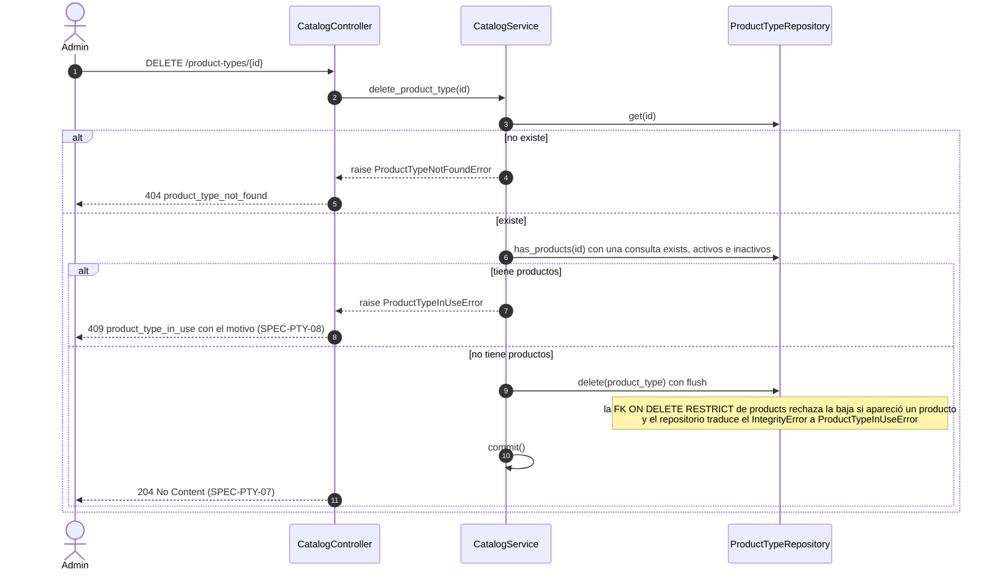

# Secuencias — 02 Tipos de producto (rubros)

Spec: [docs/domains/catalog/product-types/spec.md](spec.md)

En todos los flujos de escritura, si `current_user` no es `Admin`, `admin_required` responde 403 (SPEC-PTY-34), y sin sesión `login_required` responde 401. Para no repetirlo, solo se muestra en el primer diagrama. El controller obtiene el service con `get_catalog_service()` (`app/wiring.py`), que lo arma con el repositorio y `commit = session.commit`. Las excepciones de dominio se traducen a HTTP con la tabla de `app/controllers/errors.py`. El tipo de producto es el rubro: no tiene otros campos que `name`, y su nombre es único en todo el catálogo.

## 1. Alta y modificación de tipo de producto

Specs: SPEC-PTY-25, 26, 27, 28, 29, 30, 34, 35

```mermaid
sequenceDiagram
    autonumber
    actor Admin
    participant PC as CatalogController
    participant CS as CatalogService
    participant TR as ProductTypeRepository

    Admin->>PC: POST /product-types (name)
    alt current_user no es Admin
        PC-->>Admin: 403 forbidden (SPEC-PTY-34)
    else current_user es Admin
        PC->>CS: create_product_type(name)
        alt name ausente, vacío o que no es texto
            CS-->>PC: raise ValidationError
            PC-->>Admin: 400 validation_error con fields.name (SPEC-PTY-27)
        else name válido
            CS->>TR: find_by_name(name) por name_key
            TR-->>CS: ProductType o None
            alt ya existe sin distinguir mayúsculas
                CS-->>PC: raise DuplicateProductTypeError
                PC-->>Admin: 409 duplicate_product_type (SPEC-PTY-26)
            else no existe
                CS->>TR: add(ProductType(name)) con flush
                Note over CS,TR: el dominio recorta el nombre y calcula name_key (SPEC-PTY-28)
                CS->>CS: commit()
                PC-->>Admin: 201 ProductType con id y name (SPEC-PTY-25)
            end
        end
    end

    Note over Admin,TR: PATCH /product-types/{id} primero busca el tipo con get (404 product_type_not_found),<br/>después valida el nombre (400) y la unicidad global ignorando al propio tipo (409, SPEC-PTY-30).<br/>Un name ausente o null no modifica nada; con un name válido se guarda el cambio (SPEC-PTY-29).<br/>Cualquier otra clave del cuerpo se ignora (SPEC-PTY-35)
```

## 2. Baja de tipo de producto

Specs: SPEC-PTY-07, 08 (SPEC-PTY-08 se implementó en `03-products`)



## 3. Listado plano de tipos de producto, con búsqueda `q`

Specs: SPEC-PTY-31, 32, 33, 35

El listado no se pagina: `page` y `page_size` se ignoran (SPEC-PTY-33). `search_text(q)` devuelve `None` si `q` falta o es solo espacios, y entonces el listado se comporta como sin `q`. Cualquier otro parámetro de la query se ignora (SPEC-PTY-35).

```mermaid
sequenceDiagram
    autonumber
    actor U as Usuario autenticado
    participant PC as CatalogController
    participant CS as CatalogService
    participant TR as ProductTypeRepository

    U->>PC: GET /product-types con q opcional
    PC->>CS: list_product_types(q)
    CS->>TR: list_all(search_text(q))
    Note over TR: con q filtra por name_key que contiene q.casefold() (% y _ literales);<br/>sin q devuelve todos; ordena por name_key e id
    TR-->>CS: tipos de producto
    alt q presente
        PC-->>U: 200 lista plana de {id, name} con los tipos coincidentes (SPEC-PTY-32)
    else sin q
        PC-->>U: 200 lista plana de {id, name}, sin agrupar (SPEC-PTY-31)
    end
```
